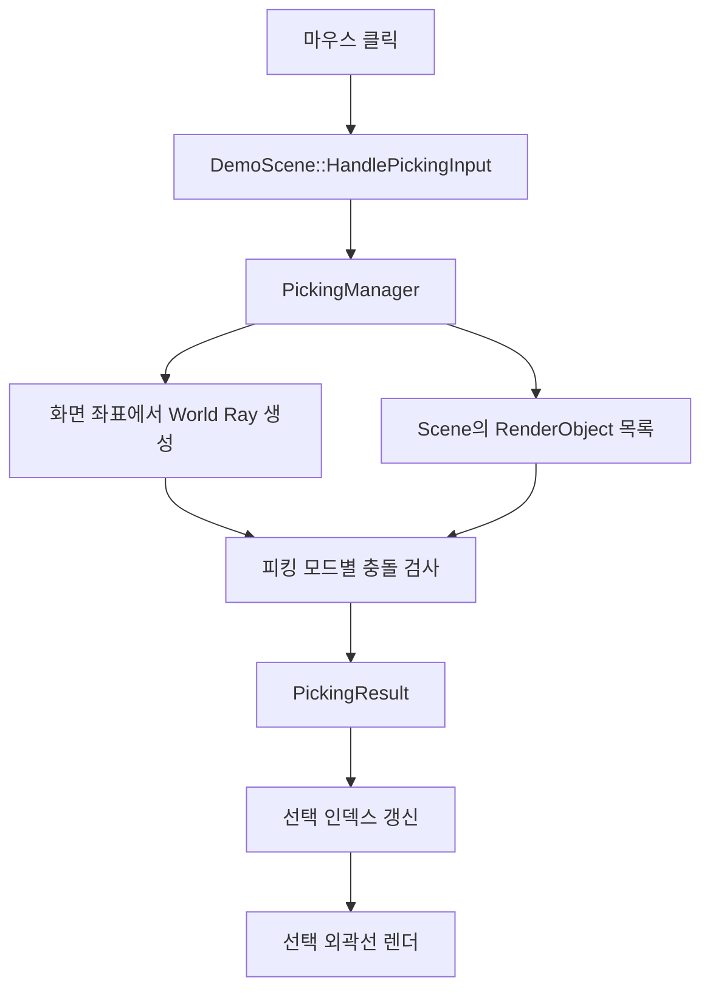
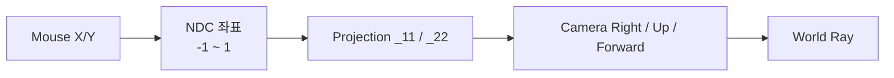
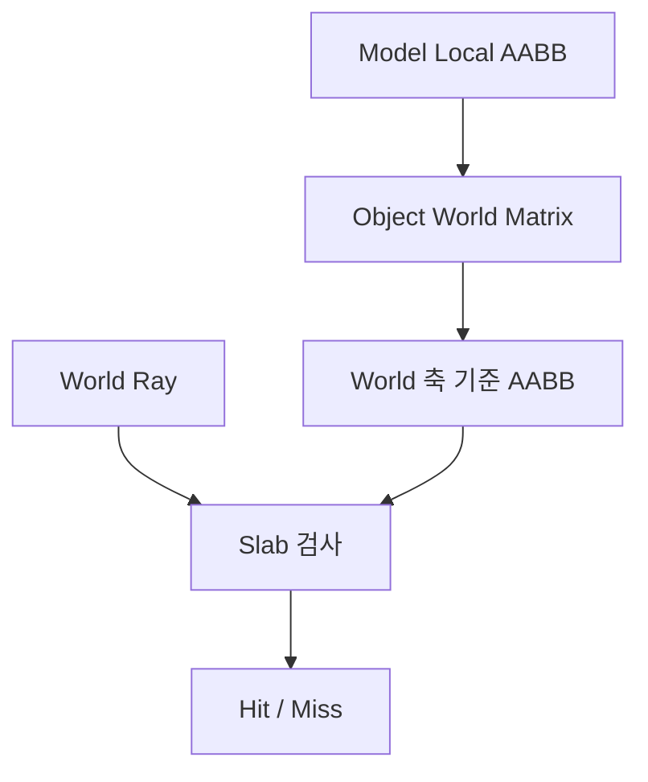
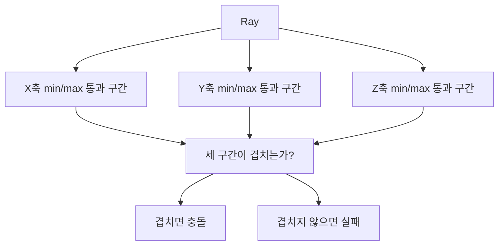
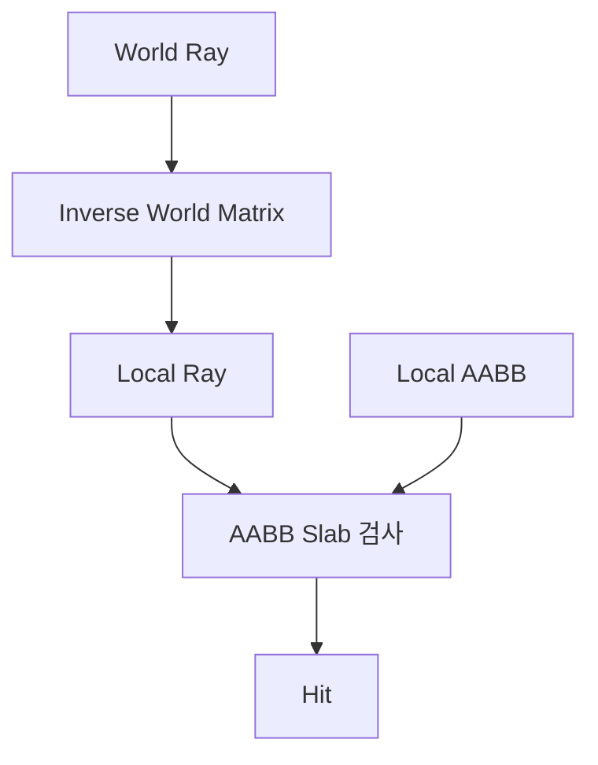
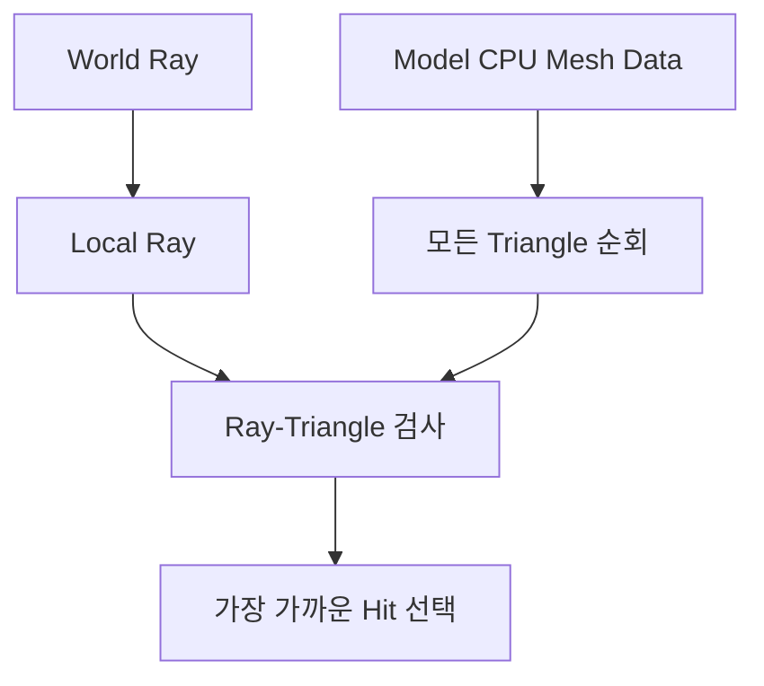
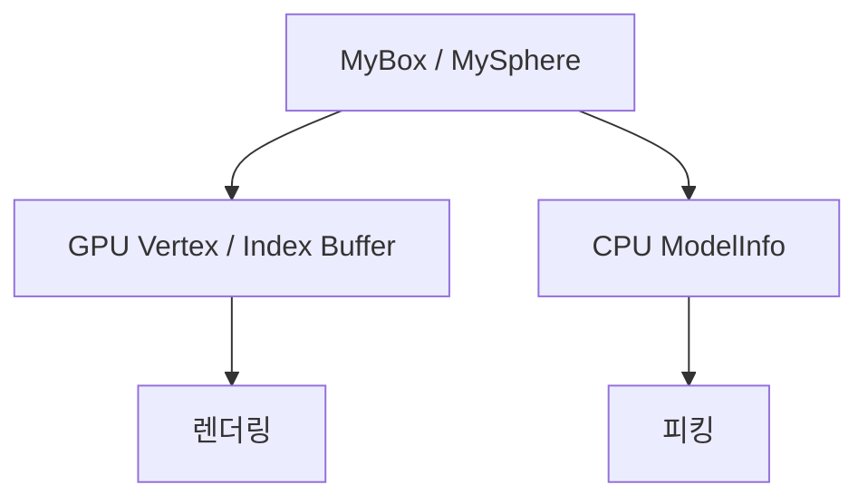
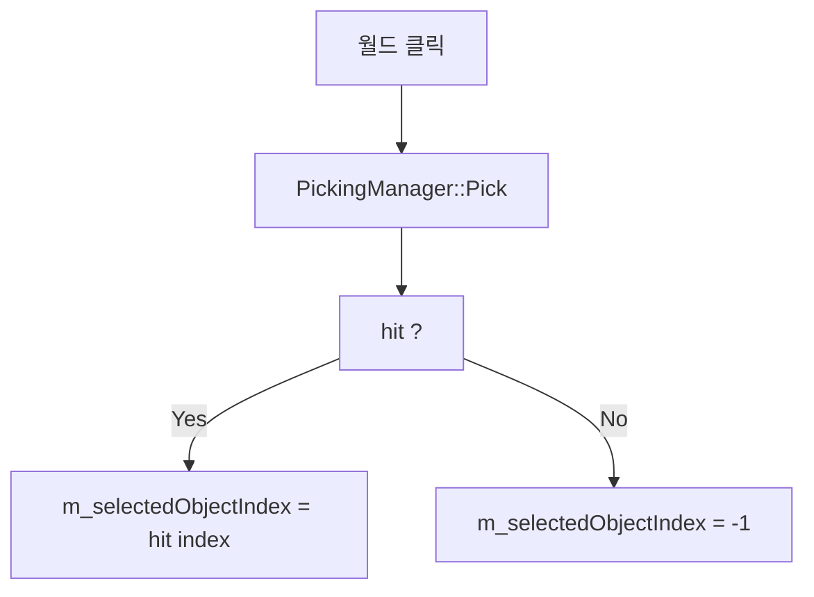
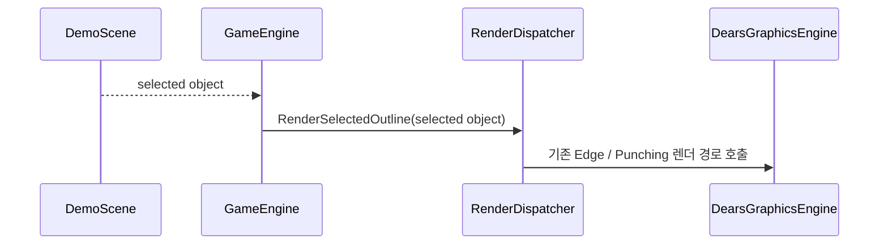

# 자체 엔진 에디터에 CPU 피킹 붙이기

오브젝트를 ImGui의 Hierarchy에서 고르는 기능은 이미 있었다.

그런데 화면 가운데 보이는 구체를 눌러도 선택되는 것은 항상 첫 번째 오브젝트였다.

처음에는 Hierarchy와 선택 인덱스가 잘못 연결된 줄 알았다. 하지만 실제로는 월드에서 어떤 오브젝트를 눌렀는지 검사하는 코드가 제대로 없었다.

언리얼처럼 월드의 오브젝트를 클릭하고 싶었다.

그리고 선택한 오브젝트의 Transform을 Inspector에서 바꾸고, 주황색 외곽선도 표시하고, Delete 키로 지울 수 있게 만들고 싶었다.

그래서 CPU Ray Picking부터 붙여보기로 했다.

현재 AABB는 기본 선택 방식으로 사용할 수 있다. OBB와 Triangle도 코드와 UI는 연결했지만, 여러 회전/스케일과 큰 메시에서 더 검증해야 한다.

## 이번에 손댄 코드

| 파일 | 역할 |
|---|---|
| `GameEngine/PickingManager.cpp` | 화면 Ray 생성과 AABB/OBB/Triangle 교차 검사를 수행한다. |
| `GameEngine/PickingManager.h` | 피킹 모드, Ray, 결과 구조를 정의한다. |
| `GameEngine/DemoScene.cpp` | 마우스 입력을 피킹 결과와 선택 인덱스, Delete 명령에 연결한다. |
| `GameEngine/PickingPanel.h` | AABB/OBB/Triangle 모드와 최근 Hit 결과를 표시한다. |
| `GameEngine/ObjectInspectorPanel.h` | 선택된 오브젝트의 Transform과 재질 값을 편집한다. |
| `GameEngine/RenderDispatcher.cpp` | 선택된 오브젝트를 기존 Stencil 외곽선 경로로 보낸다. |
| `GameEngine/RenderObject.cpp` | 외곽선 상수 버퍼와 선택 강조 색상을 갱신한다. |

처음에는 Ray와 AABB가 충돌하는지만 만들면 끝날 줄 알았다.

하지만 피킹 결과와 Hierarchy의 선택 상태가 따로 놀면 Inspector와 외곽선도 서로 다른 오브젝트를 보게 된다.

그래서 월드 클릭과 Hierarchy 클릭이 모두 같은 `m_selectedObjectIndex`를 바꾸게 했다. 충돌 함수보다 이 선택 상태를 하나로 모으는 작업이 더 중요했다.

---

## 전체 흐름부터 정리해보자



피킹은 GPU에서 그려진 픽셀을 읽는 방식이 아니라,
CPU에서 마우스 ray를 만들고 오브젝트의 충돌 영역과 직접 검사하는 방식으로 시작했다.

이 방식은 구현이 비교적 단순하고,
에디터 선택 기능의 첫 단계로 사용하기 좋다.

---

## 화면의 마우스 좌표를 어떻게 Ray로 바꿀까

마우스 클릭 위치는 처음에는 단순한 2D 화면 좌표다.
이 좌표를 3D 월드로 쏘는 ray로 바꾸기 위해 다음 과정을 거친다.



현재 구현은 ViewProjection 역행렬을 직접 뒤집는 방식 대신,
카메라가 들고 있는 basis vector를 사용한다.

```cpp
Vector3 rayDirection =
    camera->mRightDir * (ndcX / projection._11) +
    camera->mViewUp * (ndcY / projection._22) +
    camera->mViewDir;
```

이렇게 한 이유는 현재 엔진의 행렬 transpose 규칙이 여러 곳에 흩어져 있기 때문이다.
ViewProjection inverse 방식은 행렬 규칙이 조금만 어긋나도
렌더 화면과 CPU 피킹 ray가 달라질 수 있다.

그래서 지금은 실제 카메라의 right/up/forward 축을 기준으로 ray를 만드는 방식이 더 안전했다.

---

## 일단 AABB부터 시작했다

AABB는 Axis Aligned Bounding Box의 줄임말이다.
말 그대로 월드 축에 정렬된 박스로 오브젝트를 감싸고,
ray가 그 박스를 통과하는지 검사한다.



AABB 검사는 빠르고 단순하다.
하지만 오브젝트가 회전하면 실제 모양보다 박스가 커질 수 있다.

예를 들어 긴 막대기를 45도 회전시키면,
월드 축 기준 박스는 실제 막대기보다 훨씬 넓은 빈 공간까지 포함한다.
그래서 빈 공간을 클릭해도 선택되는 문제가 생길 수 있다.

그럼에도 AABB는 첫 번째 피킹 단계로 좋다.

- 빠르다.
- 구현이 단순하다.
- 대략적인 선택에는 충분하다.
- Triangle 피킹 전에 1차 필터로 쓰기 좋다.

---

## Ray와 AABB는 어떻게 충돌시키나

현재 AABB 충돌은 slab 방식으로 검사한다.

아이디어는 간단하다.

3D 박스를 X, Y, Z 축별 범위로 나누고,
ray가 각 축의 min/max 평면 사이에 들어오는 구간을 계산한다.



각 축에서 ray가 박스 안에 존재하는 거리 구간을 구하고,
세 축의 구간이 모두 겹치면 ray가 박스를 통과했다고 볼 수 있다.

---

## 회전된 물체는 OBB로 검사해보기

OBB는 Oriented Bounding Box다.
AABB와 달리 오브젝트의 회전을 반영한 박스라고 보면 된다.

현재 코드에는 OBB 피킹 함수가 있다.
방식은 박스를 월드에서 회전시키는 대신,
ray를 오브젝트 로컬 공간으로 옮긴 뒤 로컬 AABB와 검사하는 방식이다.



이 방식의 장점은 AABB 검사 코드를 재사용할 수 있다는 점이다.
오브젝트가 월드에서 회전되어 있더라도,
오브젝트 로컬 공간에서는 여전히 정렬된 박스이기 때문이다.

하지만 아직은 완성된 기능이라고 보지 않는다.

- 다양한 회전/스케일 케이스 검증이 필요하다.
- non-uniform scale에서 거리 계산이 올바른지 확인해야 한다.
- 에디터 UI에서 실제 사용성을 더 확인해야 한다.

그래서 현재 상태는 "OBB 피킹 실험 구현" 정도로 보는 것이 정확하다.

---

## 울퉁불퉁한 메시를 위해 Triangle도 붙였다

Triangle 피킹은 ray와 실제 메시 삼각형을 검사한다.
정적 메시 기준으로는 가장 정확한 피킹 방식이다.



현재 구현은 CPU에 남아있는 `ModelInfo`의 vertex/index 데이터를 기준으로 검사한다.

그래서 다음 한계가 있다.

- 정적 메시에는 사용할 수 있다.
- 스키닝된 캐릭터의 최종 변형 정점은 반영하지 않는다.
- 메시가 크면 모든 삼각형을 검사하므로 느릴 수 있다.
- 보통은 AABB 또는 OBB로 1차 필터링한 뒤 Triangle 검사를 하는 식으로 최적화한다.

즉 Triangle 피킹도 현재는 "붙여서 끝"이 아니라,
정확한 검증과 최적화가 더 필요한 상태다.

---

## 화면에는 보이는데 피킹은 안 되는 물체가 있었다

처음에는 FBX 모델만 CPU에 메시 정보가 남아 있었다.
그런데 `MyBox`, `MySphere`처럼 코드에서 만든 기본 도형은 GPU vertex buffer만 있고,
CPU에서 피킹할 수 있는 `ModelInfo`가 없었다.

그러면 화면에는 보이는데 피킹은 안 되는 이상한 상태가 된다.

그래서 절차적으로 만든 메시도 CPU용 `ModelInfo`를 만들어두도록 보완했다.



이 작업 덕분에 기본 Cube, Sphere도 피킹 대상이 될 수 있게 되었다.

---

## 아무것도 안 맞았는데 마지막 물체가 선택됐다

피킹에서 아무것도 맞지 않았을 때도 중요하다.

처음에는 아무것도 맞지 않았는데도 이전 오브젝트나 리스트의 마지막 오브젝트가
선택된 것처럼 외곽선이 그려지는 문제가 있었다.

그래서 miss가 나면 선택 인덱스를 명시적으로 비우도록 했다.



이제 아무것도 선택되지 않은 상태에서는 외곽선도 그려지지 않는다.

---

## 선택한 물체에 기존 외곽선 셰이더 연결하기

선택된 오브젝트는 기존에 만들어둔 stencil 기반 외곽선 렌더링을 사용한다.

흐름은 대략 다음과 같다.



현재는 스케일을 키운 모델을 한 번 더 그리는 방식에 가깝기 때문에,
복잡한 모델이나 버텍스가 적은 모델에서는 외곽선이 예쁘지 않을 수 있다.

특히 도끼처럼 형태가 얇고 복잡한 모델은
단순 scale 방식으로는 균일한 2~4px 외곽선을 만들기 어렵다.

나중에는 screen-space outline 또는 post-process outline으로 바꾸는 것이 더 좋아 보인다.

---

## Inspector와 Delete까지 같은 선택 상태를 사용한다

피킹이 `PickingResult`만 반환하고 끝나면 에디터 기능으로는 부족하다. `DemoScene::HandlePickingInput()`은 Hit 결과를 Scene이 공유하는 `m_selectedObjectIndex`에 반영한다. 이 인덱스를 Hierarchy, Inspector, Shadow Map 미리보기 패널이 함께 읽는다.

```text
월드 클릭 또는 Hierarchy 클릭
    -> m_selectedObjectIndex 변경
    -> Inspector가 같은 오브젝트를 표시
    -> RenderSelectedOutlinePass가 같은 오브젝트를 강조
```

Delete 키도 같은 선택 상태를 사용한다. 여기서 주의할 점은 `m_objects`의 `unique_ptr`만 먼저 지우면 `m_mainRenderItems`와 `m_shadowRenderItems`에 남아 있는 포인터가 댕글링 포인터가 된다는 것이다.

그래서 `DeleteSelectedObject()`는 다음 순서를 지킨다.

```text
1. 삭제할 RenderObject* 확인
2. Main/Shadow RenderItem에서 같은 포인터 제거
3. 이름과 생성 설정 데이터 제거
4. 마지막으로 unique_ptr 제거
5. 선택 인덱스 보정
6. Scene 저장
```

또한 ImGui가 키보드나 마우스를 사용하고 있을 때는 피킹과 Delete를 실행하지 않는다. Inspector의 입력창을 편집하다가 월드 선택이 바뀌거나 오브젝트가 삭제되는 문제를 막기 위해서다.

CubeMap과 Light는 월드에 존재하지만 메시 선택 대상으로 다루지 않는다. `RenderObject::SetPickable(false)`로 렌더 여부와 피킹 가능 여부를 분리했다. 특히 화면 전체를 감싸는 CubeMap이 Ray와 먼저 충돌해서 실제 오브젝트를 선택하지 못하는 문제를 이 방식으로 막았다.

---

## 카메라를 움직이고 나면 피킹이 안 됐다

중간에 카메라를 움직인 뒤 피킹이 맞지 않는 문제가 있었다.

원인은 ray를 만들 때 사용하는 행렬 규칙과 현재 엔진의 행렬 사용 방식이 어긋나기 쉬운 구조였기 때문이다.

현재 엔진은 좌손좌표계를 사용하고,
HLSL 쪽에서는 `mul(position, world)` 형태의 row-vector 스타일을 사용한다.
또 CPU에서 GPU로 넘길 때 여러 곳에서 `Transpose()`를 사용하고 있다.

이 규칙이 한 곳에 정리되어 있지 않으면
CPU에서 만든 피킹 ray와 GPU에서 렌더링된 화면이 서로 다른 기준을 바라볼 수 있다.

이번에는 우선 카메라의 현재 basis vector를 직접 사용해서 ray를 만들도록 고쳤다.
장기적으로는 행렬 규칙을 한 문서와 한 업로드 경로로 정리하는 것이 필요하다.

---

## 지금 어디까지 됐나

현재 피킹 상태는 다음처럼 정리할 수 있다.

| 피킹 방식 | 현재 상태 | 설명 |
|---|---|---|
| AABB | 사용 가능 | 현재 선택 기능의 중심 |
| OBB | 실험 구현 | 함수와 UI 모드는 있으나 추가 검증 필요 |
| Triangle | 실험 구현 | CPU 원본 메시 기준, 스키닝 메시 미반영 |

즉 이번 작업은 "완성된 피킹 시스템"이라기보다
"에디터 선택 기능을 위한 첫 피킹 구조를 넣었다"에 가깝다.

---

## 다음에 고칠 것

다음 피킹 작업은 아래 순서가 좋아 보인다.

1. AABB 피킹을 기준 기능으로 안정화
2. OBB 피킹을 회전/스케일 케이스로 검증
3. Triangle 피킹 전에 AABB/OBB 1차 필터를 넣어 최적화
4. Static Mesh Triangle 피킹부터 정확도 확인
5. Skinned Mesh는 별도 방식 고민
6. 선택 외곽선은 나중에 screen-space outline으로 교체 검토

정리하면 지금은 AABB를 기본 선택 방식으로 사용하고 있다.

OBB와 Triangle도 실제 코드에는 들어갔지만 아직 여러 모델로 충분히 검증하지 않았다.

그래도 월드 클릭, Hierarchy, Inspector, 외곽선과 Delete가 하나의 선택 상태로 이어지면서 이제야 에디터에서 오브젝트를 만지는 느낌이 나기 시작했다.

다음에는 OBB와 Triangle을 제대로 검증하고, 지금의 스케일 방식 외곽선도 화면 공간 방식으로 바꿔보고 싶다.
