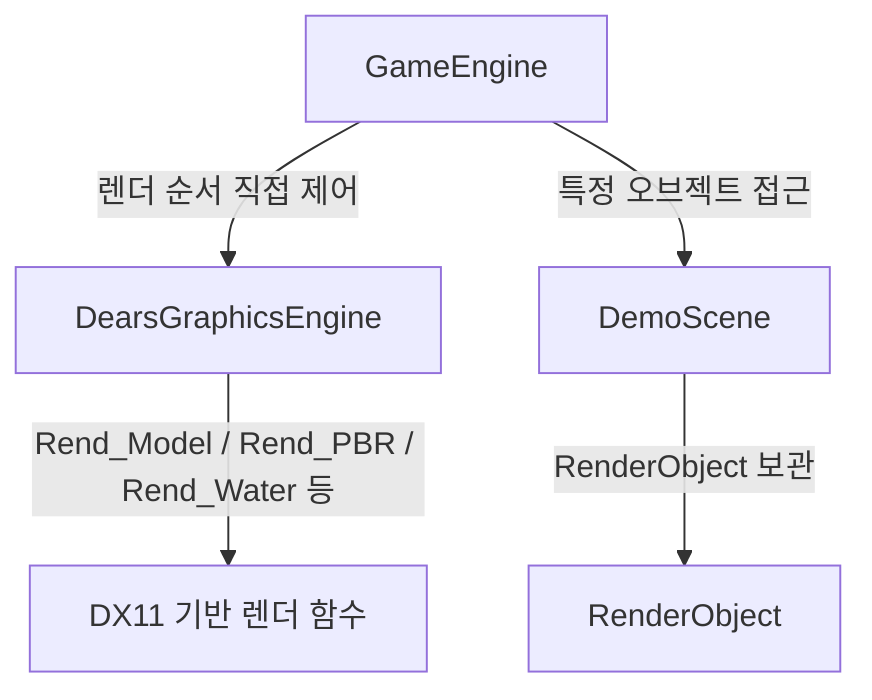
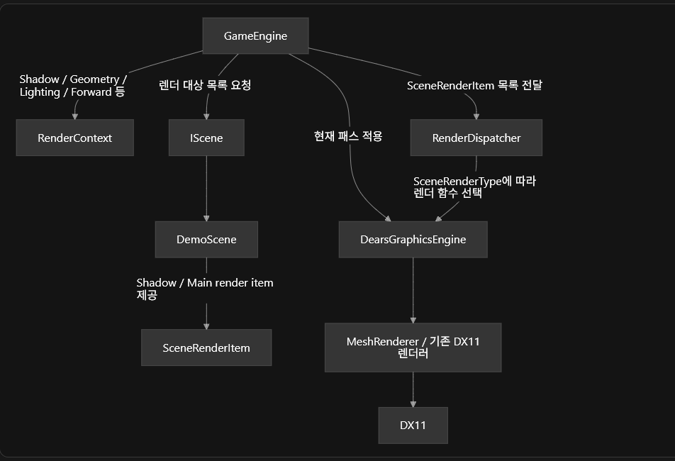
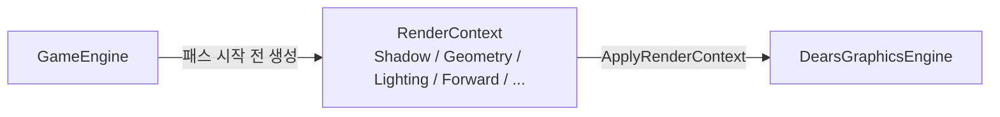
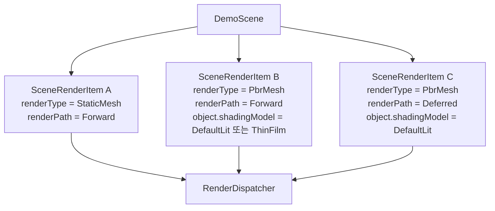
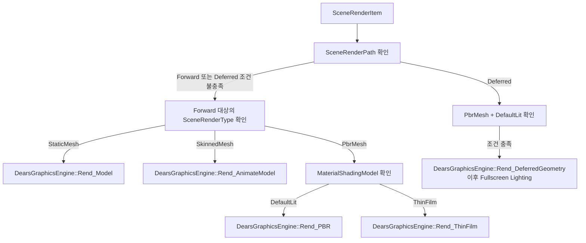
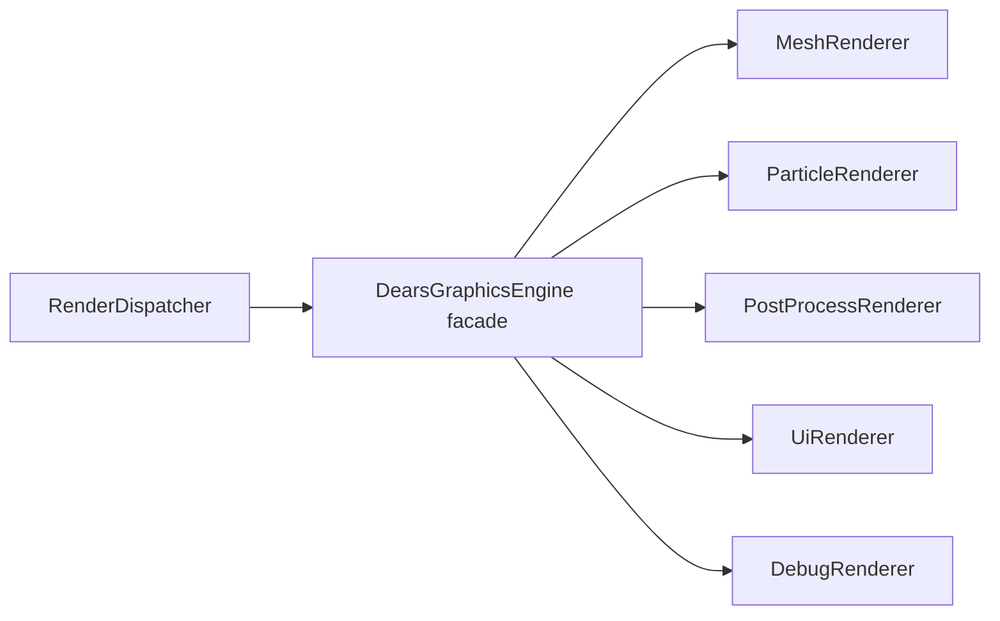
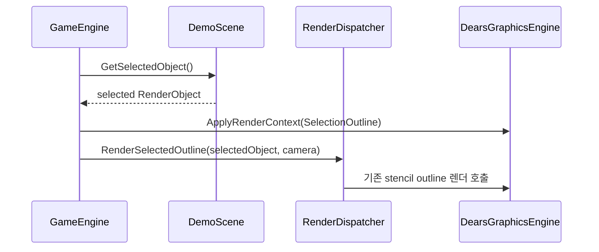
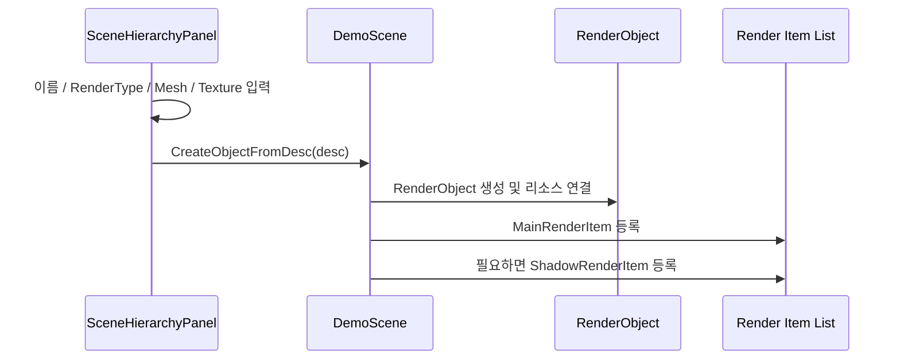
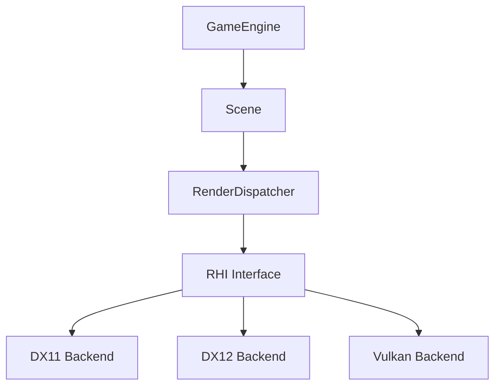

# RHI를 붙이기 전에 렌더 구조부터 나눠보기

자체 엔진에 DX12와 Vulkan을 붙여보고 싶었다.

처음에는 DX11로 되어 있는 부분을 인터페이스로 감싸면 되는 것 아닌가 생각했다.

하지만 코드를 다시 열어보니 그렇게 간단하지 않았다.

`GameEngine`이 렌더 순서도 알고 있었고, 어떤 오브젝트를 어떤 함수로 그릴지도 알고 있었다. `DemoScene`에는 오브젝트 생성 코드와 렌더 목록이 섞여 있었고, `DearsGraphicsEngine`은 메시부터 UI, 파티클, 후처리까지 거의 모든 것을 하고 있었다.

이 상태에서 DX12를 붙이면 DX11 코드를 하나 더 만드는 것이 아니라, 엔진 전체에 퍼진 렌더 호출을 같이 고쳐야 했다.

그래서 RHI 인터페이스를 바로 만들기 전에 구조부터 나누기로 했다.

이번에 먼저 분리한 것은 다음 세 가지다.

1. 렌더 패스 흐름
2. Scene이 들고 있는 렌더 대상 목록
3. SceneRenderType을 실제 그래픽스 엔진 렌더 함수로 연결하는 Dispatcher

## 이번에 손댄 코드

| 파일 | 이번 구조에서 맡은 역할 |
|---|---|
| `GameEngine/GameEngine.cpp` | 프레임의 Pass 실행 순서만 조정한다. |
| `GameEngine/IScene.h` | Scene이 엔진에 제공해야 하는 최소 계약과 `SceneRenderItem`을 정의한다. |
| `GameEngine/DemoScene.cpp` | 오브젝트를 소유하고 Shadow/Main 렌더 목록을 구성한다. |
| `GameEngine/RenderDispatcher.cpp` | Scene의 렌더 의도를 현재 그래픽스 함수와 PSO 선택으로 변환한다. |
| `DearsGraphicsEngine/RenderContext.h` | 현재 Pass 종류, Camera, 공통 상수 버퍼를 묶는다. |
| `DearsGraphicsEngine/DearsGraphicsEngine.cpp` | `RenderContext`를 받아 Pass별 출력/입력 리소스를 바인딩한다. |
| `DearsGraphicsEngine/MeshRenderer.cpp` | 메시 종류와 Shading Model에 맞는 PSO를 선택하고 Draw한다. |

파일이 꽤 많아 보이지만, 클래스를 많이 만드는 것이 목적은 아니었다.

내가 정리하고 싶었던 것은 이것이었다.

```text
누가 프레임 순서를 정하는가?
누가 그릴 오브젝트를 가지고 있는가?
누가 실제 그래픽스 함수를 알고 있는가?
```

이 세 책임이 한곳에 섞여 있던 것이 문제였다.

---

## 기존 구조에서 뭐가 문제였나

기존 구조를 단순화하면 다음과 비슷했다.



이 구조의 가장 큰 문제는 `GameEngine`이 렌더링의 상위 흐름뿐 아니라
실제 렌더링 방식까지 점점 많이 알게 된다는 점이다.

예를 들어 어떤 오브젝트를 일반 메시로 그릴지, PBR로 그릴지, Water로 그릴지 같은 판단이
엔진 루프 쪽에 퍼지기 시작하면 나중에 RHI를 붙일 때 다음 문제가 생긴다.

- DX11 전용 함수 호출을 찾기 어렵다.
- 렌더 패스가 코드상에서 명시적으로 남지 않는다.
- Scene과 GraphicsEngine의 책임 경계가 흐려진다.
- DX12/Vulkan 백엔드를 붙일 때 게임 코드까지 같이 흔들릴 수 있다.

---

## 일단 이런 구조로 바꿨다

이번 작업 이후의 흐름은 다음과 같다.



처음 이 그림을 보면 선이 꽤 많아서 복잡해 보인다.

하지만 크게 보면 두 가지 흐름이다.

```text
1. 이번에는 어떤 Pass를 실행할지 준비하는 흐름
   GameEngine -> RenderContext -> DearsGraphicsEngine

2. 이번 Pass에서 무엇을 그릴지 전달하는 흐름
   GameEngine -> IScene/DemoScene -> SceneRenderItem
              -> RenderDispatcher -> DearsGraphicsEngine
```

이 둘이 `DearsGraphicsEngine`에서 만난다.

하나는 현재 렌더 타깃과 카메라 같은 상태를 준비하고, 다른 하나는 그 상태에서 실제로 그릴 오브젝트를 보낸다.

## 다이어그램을 실제 코드 순서로 따라가 보기

### 시작은 GameEngine::Render()

한 프레임의 가장 위에는 `GameEngine::Render()`가 있다.

```cpp
void GameEngine::Render()
{
    m_pDearsGraphicsEngine->BeginRender();

    RenderDemoOverlay();
    RenderShadowPass();
    RenderGeometryPass();
    RenderLightingPass();
    RenderForwardPass();
    RenderSelectedOutlinePass();
    RenderParticlePass();
    RenderPostProcessPass();
    RenderDebugPass();

    m_pDearsGraphicsEngine->EndRender();
}
```

예전에는 이 안에서 오브젝트를 하나씩 꺼내 실제 렌더 함수까지 호출하는 코드가 많았다.

지금은 한 프레임에 어떤 Pass를 어떤 순서로 실행할지만 보이게 만들었다.

```text
GameEngine이 아는 것
    Shadow 다음에는 Geometry가 온다.
    Geometry 다음에는 Lighting이 온다.
    그 뒤에 Forward와 Outline을 그린다.

GameEngine이 몰라도 되는 것
    PBR 메시가 PBRPSO를 사용하는가?
    스키닝 메시는 어떤 Vertex Shader를 사용하는가?
    DX11의 어떤 함수를 호출해야 하는가?
```

이 구분이 중요한 이유는 DX12나 Vulkan을 붙여도 프레임의 큰 순서 자체는 거의 같기 때문이다.

백엔드가 달라져도 Shadow 다음에 Geometry를 실행한다는 사실은 바뀌지 않는다.

### 첫 번째 흐름: RenderContext로 이번 Pass를 준비한다

예를 들어 Geometry Pass를 실행한다고 해보자.

`GameEngine::RenderGeometryPass()`는 먼저 `RenderContext`를 만든다.

```cpp
RenderContext geometryContext;
geometryContext.passType = RenderPassType::Geometry;
geometryContext.camera = tempCamera.get();
geometryContext.commonBuffer = &tempCCConstantBuffer;

m_pDearsGraphicsEngine->ApplyRenderContext(geometryContext);
```

`RenderContext`에는 지금 필요한 최소 상태만 들어 있다.

```text
passType
    지금 Shadow인지 Geometry인지 Forward인지 구분한다.

camera
    이번 Pass에서 사용할 View/Projection의 기준이다.

commonBuffer
    카메라와 라이트처럼 여러 Draw가 같이 사용하는 데이터다.
```

여기서 중요한 점은 `RenderContext`가 오브젝트를 그리지 않는다는 것이다.

이 구조체는 이번 무대를 준비한다.

`DearsGraphicsEngine::ApplyRenderContext()`는 `passType`을 보고 Pass에 맞는 리소스를 바인딩한다.

```text
Geometry
    -> G-Buffer의 Albedo/Normal/Material RTV와 Depth DSV 바인딩

Lighting
    -> G-Buffer를 SRV로 전환하고 백 버퍼를 출력으로 바인딩

Forward
    -> G-Buffer SRV를 해제하고 Geometry Depth를 다시 DSV로 바인딩
```

DX11에서는 주로 RTV, DSV, SRV를 묶고 해제하는 코드로 보인다.

하지만 DX12나 Vulkan에서는 이 위치에서 Resource State Transition과 Barrier를 기록해야 한다.

그래서 `ApplyRenderContext()`는 나중에 RHI의 CommandList가 Pass를 시작하는 경계가 될 수 있다.

### 두 번째 흐름: IScene에 그릴 목록을 요청한다

무대를 준비했으면 이제 무엇을 그릴지 알아야 한다.

`GameEngine`은 구체적인 `DemoScene`에 직접 접근하지 않고 `IScene` 인터페이스를 통해 목록을 요청한다.

```cpp
const std::vector<SceneRenderItem>& GetShadowRenderItems() const;
const std::vector<SceneRenderItem>& GetMainRenderItems() const;
```

그림에서 `IScene -> DemoScene` 화살표는 목록이 실제로 두 객체를 통과해서 복사된다는 뜻은 아니다.

현재 활성 Scene을 `IScene*`로 들고 있고, 런타임의 실제 객체가 `DemoScene`이라는 뜻이다.

```text
GameEngine
    -> IScene 계약만 알고 있음

현재 실행 중인 구현
    -> DemoScene
```

나중에 `GameScene`, `MaterialTestScene`, `RayTracingTestScene`을 만들더라도 `IScene`의 계약만 지키면 `GameEngine`의 렌더 흐름은 그대로 사용할 수 있다.

### DemoScene은 RenderObject를 소유하고 SceneRenderItem을 제공한다

`DemoScene`은 실제 오브젝트의 수명을 소유한다.

```text
m_objects
    -> unique_ptr<RenderObject>

m_shadowRenderItems
    -> Shadow Pass에 제출할 목록

m_mainRenderItems
    -> Geometry/Forward Pass에 제출할 목록
```

`SceneRenderItem`은 오브젝트 자체를 소유하지 않는다.

```cpp
struct SceneRenderItem
{
    RenderObject* object = nullptr;
    SceneRenderType renderType = SceneRenderType::StaticMesh;
    SceneRenderPath renderPath = SceneRenderPath::Forward;
};
```

`object`는 실제 `RenderObject`를 가리키고, 나머지 값은 그 오브젝트를 어떻게 제출할지 알려주는 정보다.

```text
SceneRenderType
    무엇인가?
    StaticMesh / SkinnedMesh / PbrMesh / CubeMap ...

SceneRenderPath
    어느 경로로 그릴 것인가?
    Forward / Deferred
```

목록에는 포인터만 들어 있으므로 오브젝트를 삭제할 때는 주의해야 한다.

`unique_ptr`을 먼저 지우면 RenderItem에 잘못된 포인터가 남는다. 그래서 현재 삭제 코드는 Shadow/Main 목록에서 같은 포인터를 먼저 제거한 뒤 실제 오브젝트를 지운다.

### GameEngine은 목록을 RenderDispatcher에 넘긴다

Geometry Pass에서는 다음 한 줄로 목록을 넘긴다.

```cpp
m_pRenderDispatcher->RenderGeometryItems(
    m_pActiveScene->GetMainRenderItems());
```

GameEngine은 목록 안에 구체가 있는지, 캐릭터가 있는지 확인하지 않는다.

그 판단은 `RenderDispatcher`가 한다.

```cpp
if (item.renderPath == SceneRenderPath::Deferred &&
    item.renderType == SceneRenderType::PbrMesh &&
    item.object->GetShadingModel() == MaterialShadingModel::DefaultLit)
{
    RenderGeometryItem(item);
}
```

현재 Geometry Pass는 모든 오브젝트를 받지 않는다.

```text
Deferred Path
+ PBR Mesh
+ Default Lit Shading Model
```

이 세 조건을 만족한 오브젝트만 G-Buffer에 기록한다.

Thin Film은 전용 Pixel Shader가 최종 색상을 직접 계산하므로 아직 Forward에 남아 있다.

### Dispatcher는 Pass와 오브젝트 종류를 같이 보고 함수를 고른다

같은 오브젝트라도 Pass에 따라 필요한 셰이더가 다르다.

PBR 메시 하나를 예로 들면 다음과 같다.

```text
Shadow Pass
    -> RenderPbrDepthMap()
    -> Height 변형을 포함한 Shadow Vertex Shader

Geometry Pass
    -> Rend_DeferredGeometry()
    -> Albedo/Normal/Material을 G-Buffer에 기록

Forward Pass + Default Lit
    -> Rend_PBR()
    -> PBRPSO

Forward Pass + Thin Film
    -> Rend_ThinFilm()
    -> ThinFilmPSO
```

즉 `SceneRenderType::PbrMesh` 하나만 보고 무조건 같은 함수를 호출하지 않는다.

현재 어떤 Pass인지, 오브젝트가 어떤 Render Path인지, 어떤 Shading Model인지 같이 봐야 한다.

Shadow Pass에서는 또 다른 기준이 필요하다.

```text
StaticMesh
    -> 일반 Depth Shader

PbrMesh
    -> Height Map을 적용하는 PBR Shadow Shader

SkinnedMesh
    -> Bone Transform을 적용하는 Animation Shadow Shader

EquipmentMesh
    -> Target Bone Transform을 적용하는 Equipment Shadow Shader
```

그림의 `SceneRenderType에 따라 렌더 함수 선택` 화살표가 이 부분이다.

### DearsGraphicsEngine은 아직 DX11 그래픽스 계층의 입구다

Dispatcher가 `Rend_PBR()`을 선택하면 바로 DX11 Draw를 호출하는 것은 아니다.

현재 호출 흐름은 다음과 같다.

```text
RenderDispatcher::RenderForwardItem()
    -> DearsGraphicsEngine::Rend_PBR()
        -> MeshRenderer::RenderPbrModel()
            -> SetPipelineState(PBRPSO)
            -> Renderer::Render(ModelBuffer*)
                -> DX11 DrawIndexed()
```

`DearsGraphicsEngine`은 바깥에서 사용하는 facade에 가깝고, 실제 메시 PSO 선택은 `MeshRenderer`가 담당한다.

마지막의 `Renderer`는 Vertex/Index Buffer와 Constant Buffer를 DX11 Context에 연결하고 Draw Call을 실행한다.

따라서 그림의 아래쪽으로 갈수록 추상적인 게임 개념에서 구체적인 GPU 명령으로 내려간다.

```text
위쪽
    GameEngine / Scene
    -> Pass 순서와 렌더 의도

중간
    Dispatcher / DearsGraphicsEngine / MeshRenderer
    -> 렌더 경로와 PSO 선택

아래쪽
    Renderer / DX11
    -> Buffer 바인딩과 Draw Call
```

## Deferred PBR 오브젝트 하나를 끝까지 따라가 보면

Add Object에서 `PBR Mesh + Deferred + Default Lit` 오브젝트를 하나 만들었다고 해보자.

한 프레임 동안 이 오브젝트는 다음 흐름을 탄다.

```text
1. Shadow Pass
   GameEngine이 Shadow RenderContext 적용
   -> DemoScene의 ShadowRenderItems 요청
   -> Dispatcher가 PbrMesh 확인
   -> PBR Shadow Shader로 Shadow Map Depth 기록

2. Geometry Pass
   GameEngine이 Geometry RenderContext 적용
   -> G-Buffer MRT 바인딩
   -> DemoScene의 MainRenderItems 요청
   -> Dispatcher가 Deferred + PbrMesh + DefaultLit 확인
   -> DeferredGeometryPixelShader로 G-Buffer 기록

3. Lighting Pass
   G-Buffer를 SRV로 전환
   -> 현재는 최종 Deferred Lighting Draw가 아직 없음

4. Forward Pass
   Geometry Depth를 다시 DSV로 연결
   -> 현재는 화면 출력을 유지하기 위해 Deferred PBR도 Rend_PBR로 한 번 더 그림

5. Outline Pass
   이 오브젝트가 선택되어 있다면 Stencil 기반 외곽선을 추가로 그림
```

여기서 4번은 최종 구조가 아니다.

Deferred Lighting Pass가 완성되면 Deferred 오브젝트의 Forward 중복 Draw를 제거하고, 투명 오브젝트나 Thin Film 같은 특수 재질만 Forward에 남길 예정이다.

> **후속 구현 메모 (2026-07-20)**
> 이 부분은 렌더 구조를 처음 분리했을 당시의 구현 상태를 그대로 남긴 것이다. 당시 `RenderLightingPass()`는 G-Buffer를 SRV로 전환하는 경계만 있었고 실제 Fullscreen Lighting Draw는 없었다. 이후 [디퍼드 렌더링 작업](./2026-07-13-deferred-rendering-progress.md)에서 Fullscreen Triangle 기반 Lighting Pass를 구현하고, Deferred Default Lit PBR의 Forward 중복 Draw도 제거했다.

## RenderContext와 SceneRenderItem을 굳이 나눈 이유

실제로 처음 구조에서는 패스 상태와 오브젝트 정보가 한 렌더 단위 안에 함께 들어 있었다. 오브젝트 하나를 그릴 때 필요한 값을 한 번에 넘길 수 있으니 처음에는 단순해 보였다.

하지만 두 데이터는 사용 범위와 갱신 주기가 다르다.

```text
RenderContext
    Pass 한 번에 하나
    여러 Draw가 공유하는 상태
    Camera / Render Target / 공통 리소스

SceneRenderItem
    오브젝트마다 하나
    Draw마다 달라지는 정보
    Object / RenderType / RenderPath
```

Geometry Pass 하나를 시작할 때 `RenderContext`는 한 번만 적용한다. 그 뒤 수십 개의 `SceneRenderItem`을 같은 Camera와 G-Buffer 상태에서 그린다.

### 합쳐두면 공통 데이터가 오브젝트마다 반복된다

둘을 오브젝트 단위 구조체 하나로 합치면 모든 오브젝트가 같은 Camera, Render Target, 공통 리소스 포인터를 반복해서 보관하게 된다. 현재 `RenderContext`는 포인터 위주라 중복 크기가 아주 크지는 않지만, 오브젝트 수가 늘어나고 Viewport, Clear 값, Attachment, Resource Transition 같은 패스 정보가 추가될수록 낭비도 함께 커진다.

```text
분리한 경우
    RenderContext 1개
    + SceneRenderItem N개

합친 경우
    (RenderContext + SceneRenderItem) N개
```

### 같은 GPU 상태를 Draw마다 반복해서 적용하기 쉽다

구조체를 합쳤다는 사실만으로 상태 변경이 반드시 반복되는 것은 아니다. 하지만 합친 구조체를 오브젝트별 Draw 제출 단위로 사용하면 Camera 상수 버퍼 갱신과 Render Target 바인딩까지 매번 함께 수행하는 인터페이스를 만들기 쉽다.

```text
합친 구조를 오브젝트마다 적용
    Object A: Camera 설정 + G-Buffer 바인딩 + Draw
    Object B: Camera 설정 + G-Buffer 바인딩 + Draw
    Object C: Camera 설정 + G-Buffer 바인딩 + Draw

현재 구조
    Geometry Pass: Camera 설정 + G-Buffer 바인딩 1회
    Object A Draw
    Object B Draw
    Object C Draw
```

따라서 분리의 핵심은 **오브젝트 수만큼 필요한 데이터와 패스마다 한 번 필요한 데이터를 서로 다른 단위로 보관하고 적용하는 것**이다. `RenderContext`는 패스가 소유하고, `SceneRenderItem`은 Draw 목록이 소유한다.

### 구조를 나누면서 함께 고친 별도 버그

과거에는 Geometry Pass가 G-Buffer를 바인딩한 뒤, 첫 번째 오브젝트의 개별 Draw가 끝나면서 Render Target을 Back Buffer로 되돌리고 있었다. 그래서 첫 번째 오브젝트만 G-Buffer에 기록되고 나머지 오브젝트는 Back Buffer에 그려지는 문제가 있었다.

이 버그는 `RenderContext`와 `SceneRenderItem`이 합쳐져 있어서 필연적으로 발생한 것은 아니다. 개별 Draw 함수가 자신이 소유하지 않은 패스 상태까지 변경하도록 잘못 작성한 것이 직접적인 원인이었다.

다만 이 문제를 고치면서 소유 규칙을 분명하게 정했다.

```text
Pass
    Camera / Render Target / 공통 리소스를 설정하고 유지

Draw
    Object / Mesh / Material을 바인딩하고 그리기만 함
    Pass가 정한 Render Target을 임의로 변경하지 않음
```

즉, 구조를 나눈 이유는 Back Buffer 버그 하나 때문이 아니라 **서로 다른 사용 범위, 메모리 중복, 반복 상태 적용과 소유권을 코드에 명확히 표현하기 위해서**다. Back Buffer 문제는 이 원칙을 정리하는 과정에서 함께 수정한 별도의 버그였다.

## 이 구조에서 RHI를 붙일 때 바뀌는 곳

이 다이어그램의 위쪽은 되도록 그대로 두는 것이 목표다.

```text
유지하고 싶은 부분
    GameEngine의 Pass 순서
    IScene의 렌더 목록 계약
    SceneRenderItem의 렌더 의도
    Dispatcher의 오브젝트 분류

교체해야 하는 부분
    DearsGraphicsEngine 내부의 DX11 리소스
    MeshRenderer의 DX11 PSO
    Renderer의 DeviceContext 호출
    Buffer/Texture/Shader 생성 방식
```

최종적으로 Dispatcher 아래가 다음처럼 바뀌는 것이 목표다.

```text
현재
RenderDispatcher
    -> DearsGraphicsEngine
        -> MeshRenderer
            -> DX11 Renderer

목표
RenderDispatcher
    -> RHI CommandList / Render Backend
        -> DX11 또는 DX12 또는 Vulkan
```

따라서 지금 구조 수정은 RHI를 완성한 작업은 아니다.

RHI를 붙일 때 게임 코드까지 같이 뜯어고치지 않도록, 바뀌는 영역을 다이어그램 아래쪽으로 모으는 작업에 가깝다.

핵심은 `GameEngine`이 이제 개별 렌더 함수보다 상위 개념을 다루게 되었다는 점이다.

`GameEngine`의 관심사는 다음에 가깝다.

- 지금 Shadow Pass를 돌릴 차례인가?
- 지금 Main Scene Pass를 돌릴 차례인가?
- 선택된 오브젝트의 Outline Pass를 돌릴 차례인가?
- 현재 Scene이 어떤 렌더 대상들을 가지고 있는가?

반대로 어떤 `RenderObject`가 실제로 어떤 DX11 함수로 들어갈지는
`RenderDispatcher`가 담당한다.

---

## 현재 Pass를 코드도 알게 만들기

`RenderContext`는 현재 렌더 패스가 무엇인지 그래픽스 엔진에 알려주기 위해 추가했다.



예전에도 함수 이름만 보면 `RenderShadowPass()` 같은 구분은 있었다.
하지만 그 정보는 사람만 읽을 수 있는 함수 이름에 가까웠다.

`RenderPassType`을 두면 코드도 현재 패스가 무엇인지 알 수 있다.
나중에 다음과 같은 작업을 할 때 이 정보가 유용해진다.

- 패스별 렌더 상태 검증
- 패스별 디버그 로그 출력
- RHI CommandList 기록 구간 분리
- RenderGraph 또는 FrameGraph로 확장

---

## Scene은 무엇을 그릴지만 알려준다

Scene은 이제 렌더할 오브젝트를 `SceneRenderItem` 형태로 넘긴다.

```cpp
struct SceneRenderItem
{
    RenderObject* object = nullptr;
    SceneRenderType renderType = SceneRenderType::StaticMesh;
    SceneRenderPath renderPath = SceneRenderPath::Forward;
};
```

여기서 중요한 점은 모든 렌더 대상이 단순히 `RenderObject*`만으로 넘어가지 않는다는 것이다.

`renderType`은 메시가 어떤 종류인지 나타내고, `renderPath`는 그 메시를 Forward와 Deferred 중 어디에 제출할지 나타낸다. 둘을 분리하지 않으면 `PbrMesh`라는 하나의 값이 메시 종류와 프레임 실행 위치를 동시에 의미하게 된다.

```text
renderType = 무엇을 그리는가?
    StaticMesh / SkinnedMesh / PbrMesh / CubeMap / Light ...

renderPath = 언제, 어느 경로에서 그리는가?
    Forward / Deferred
```



위의 A, B, C는 서로 다른 클래스나 Pass가 아니다. 모두 같은 `SceneRenderItem` 구조체에 서로 다른 enum 값이 들어간 예시다. 현재 코드에 별도의 `SceneRenderItem PBR` 타입은 없으며, PBR 메시는 `renderType = PbrMesh` 하나로 표현한다. 이후 `renderPath`가 Forward인지 Deferred인지에 따라 제출할 Pass가 갈린다.

```text
StaticMesh + Forward
    -> Forward Pass에서 일반 정적 메시로 Draw

PbrMesh + Forward
    -> Forward Pass에서 Draw
    -> DefaultLit이면 Rend_PBR
    -> ThinFilm이면 Rend_ThinFilm

PbrMesh + Deferred + DefaultLit
    -> Geometry Pass에서 G-Buffer 기록
    -> Lighting Pass가 화면 전체의 최종 조명 계산
```

즉 Scene은 "이 오브젝트는 이런 방식으로 그려야 한다"는 의도를 표현하고,
실제 DX11 함수 호출은 Dispatcher로 넘긴다.

---

## 실제 렌더 함수 선택은 Dispatcher로 옮겼다

`RenderDispatcher`는 Scene과 GraphicsEngine 사이에 있는 얇은 변환 계층이다.



아직은 내부에서 DX11 기반 `DearsGraphicsEngine` 함수를 호출한다.
그래서 이것만으로 RHI가 완성된 것은 아니다.

하지만 효과는 분명하다.

- Scene은 DX11 렌더 함수 이름을 몰라도 된다.
- GameEngine은 렌더 타입별 세부 호출을 몰라도 된다.
- 나중에 RHI를 붙일 때 Dispatcher 뒤쪽을 바꾸는 방향으로 확장할 수 있다.

`RenderDispatcher`가 곧 RHI라는 뜻은 아니다. 현재 Dispatcher는 여전히 `Rend_PBR()` 같은 엔진의 DX11 구현 함수를 알고 있다. 다만 이 의존성이 Scene과 GameEngine 전체에 퍼지지 않고 한 곳에 모였다는 것이 중요하다.

---

## DearsGraphicsEngine도 너무 많은 일을 하고 있었다

기존 `DearsGraphicsEngine`은 메시, 파티클, 후처리, UI, 디버그 렌더링과 리소스 조회를 한 클래스 안에서 모두 처리하는 방향으로 커지고 있었다. 기능이 추가될수록 RHI를 만들기 전에 거대한 DX11 클래스 하나를 그대로 복제할 가능성이 높았다.

그래서 기능별 구현을 다음 객체로 옮겼다.

| 클래스 | 책임 |
|---|---|
| `MeshRenderer` | 정적/스키닝/PBR/Shadow 메시의 PSO 선택과 Draw |
| `ParticleRenderer` | 파티클 렌더 경로 |
| `PostProcessRenderer` | 후처리 렌더 경로 |
| `UiRenderer` | ImGui 패널 등록과 UI 렌더링 |
| `DebugRenderer` | 월드 공간 선과 디버그 도형 렌더링 |
| `GraphicsResourceManager` | 모델, 텍스처, 셰이더 리소스 조회 경계 |

이 분리는 클래스 수를 늘리려는 목적이 아니다. 예를 들어 `RenderDispatcher`가 PBR 메시를 선택하면 `DearsGraphicsEngine`을 거쳐 `MeshRenderer::RenderPbrModel()`로 들어가고, 그곳에서 `PBRPSO`를 선택한다. 프레임 순서와 PSO 선택 책임이 서로 다른 파일에 놓이게 된 것이다.



`DearsGraphicsEngine`은 아직 DX11 장치와 Context를 소유하는 facade다. 이후 RHI를 도입할 때는 이 내부 구현들이 공통 `Buffer`, `Texture`, `Pipeline`, `CommandList` 인터페이스를 사용하도록 한 단계씩 밀어낼 수 있다.

---

## 선택 외곽선도 하나의 Pass로 보기

선택된 오브젝트 외곽선도 별도 패스로 분리했다.



선택 상태는 Scene이 관리하고,
선택된 대상을 어떤 방식으로 외곽선 렌더링할지는 Dispatcher가 결정한다.

이렇게 나눈 이유는 선택 기능이 에디터/게임 쪽 개념에 가깝고,
외곽선 렌더링은 그래픽스 쪽 개념에 가깝기 때문이다.

---

## 오브젝트 생성 흐름도 같이 정리했다

기본 오브젝트 자동 생성을 끄고,
ImGui에서 Add Object를 통해 오브젝트를 생성하는 흐름도 추가했다.



이 작업은 RHI 자체와 직접 관련되지는 않지만,
렌더 대상이 어디서 생기고 어떤 렌더 리스트에 들어가는지 명확하게 만들기 위한 준비다.

이제 화면에 무엇이 뜨는지는 Scene의 기본 하드코딩보다
에디터에서 생성한 오브젝트와 렌더 리스트가 결정한다.

---

## 그럼 이제 RHI가 붙은 것인가?

이번 작업은 "DX11 코드를 제거했다"가 아니다.
정확히는 DX11에 도달하기 전 단계의 책임을 나눴다.

앞으로 목표 구조는 다음에 가깝다.



지금은 아직 이 중간의 `RHI Interface`가 없다.
하지만 `GameEngine`과 `Scene`이 DX11 함수에 직접 기대는 부분을 줄이고 있기 때문에,
나중에 `RenderDispatcher -> RHI` 형태로 바꾸기가 쉬워진다.

---

## 이번에 바뀐 것

- 렌더 패스를 함수 이름뿐 아니라 `RenderPassType`으로 명시했다.
- Scene이 렌더 대상 목록을 `SceneRenderItem`으로 제공하게 했다.
- 메시 종류인 `SceneRenderType`과 제출 경로인 `SceneRenderPath`를 분리했다.
- `RenderDispatcher`가 `SceneRenderType`을 실제 렌더 함수로 연결하게 했다.
- 그래픽스 엔진 내부의 메시, 파티클, 후처리, UI, 디버그, 리소스 책임을 나눴다.
- 선택 외곽선 렌더링을 별도 패스로 분리했다.
- 기본 오브젝트 자동 생성을 끄고, 에디터에서 오브젝트를 추가하는 흐름을 만들었다.

---

## 아직 남은 것

아직 구조 수정은 끝난 것이 아니다.
RHI를 붙이려면 다음 단계가 더 필요하다.

1. `DearsGraphicsEngine`의 DX11 리소스 생성 함수를 RHI 친화적인 인터페이스로 감싸기
2. Buffer / Texture / Shader / PipelineState를 DX11 타입에서 분리하기
3. `RenderDispatcher`가 DX11 함수 대신 RHI CommandList에 명령을 기록하도록 바꾸기
4. DX11 Backend를 먼저 RHI 뒤로 밀어 넣기
5. 이후 DX12 / Vulkan Backend 추가하기

정리하면 아직 RHI가 생긴 것은 아니다.

DX11 코드는 그대로 남아 있고, `RenderDispatcher` 뒤쪽도 아직 현재 그래픽스 엔진 함수를 호출한다.

그래도 이제 어디부터 바꿔야 할지는 전보다 훨씬 잘 보인다.

이번 작업은 RHI 구현이라기보다, 게임 코드와 렌더 백엔드 사이에 뒤늦게 경계선을 그어본 작업에 가깝다.
