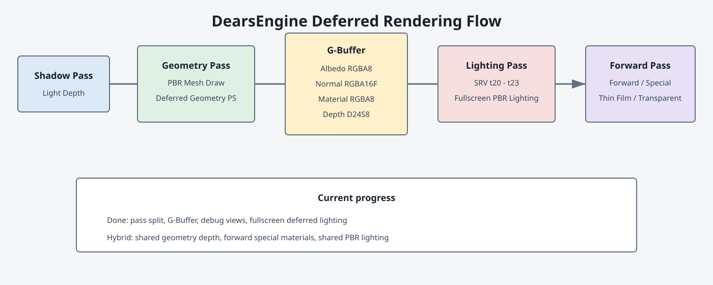
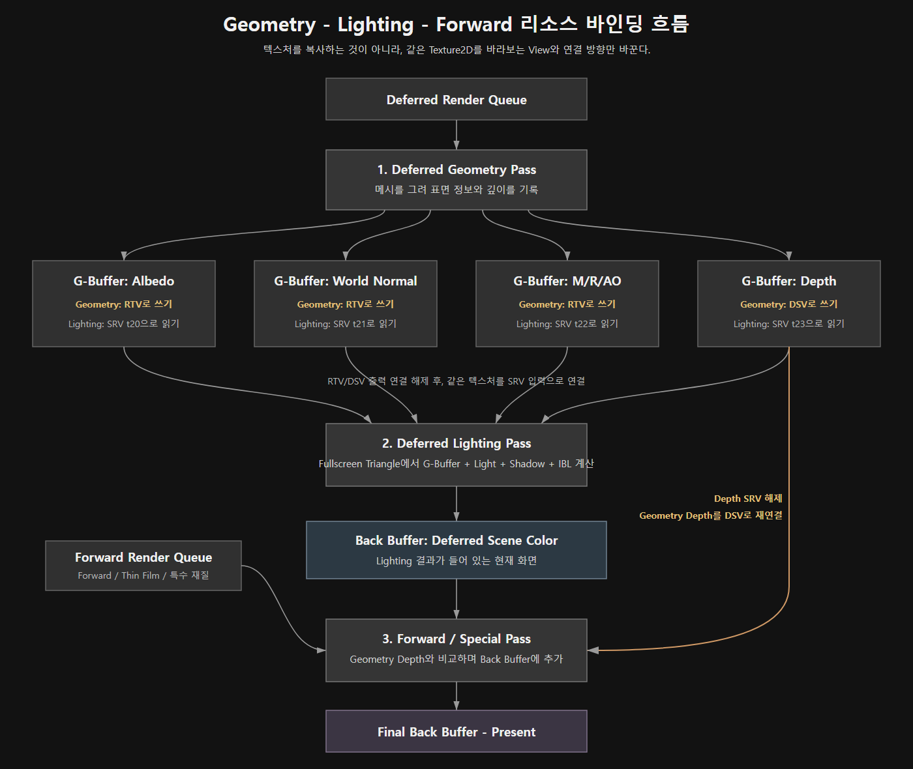
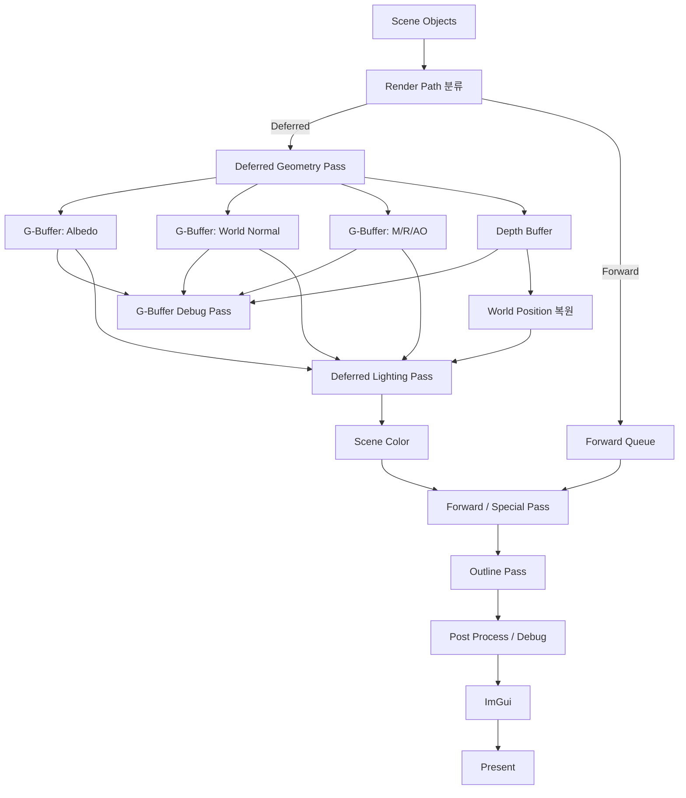

# 자체 엔진에 디퍼드 렌더링 붙이기 - G-Buffer부터 Fullscreen Lighting까지

PBR 오브젝트가 포워드 렌더링으로 화면에 나오기 시작했다.

그다음에는 디퍼드 렌더링도 붙여보고 싶었다.

처음에는 G-Buffer용 Render Target을 몇 장 만들고, PBR 셰이더의 출력만 나눠 담으면 되는 것 아닌가 생각했다.

하지만 바로 G-Buffer부터 만들 수는 없었다.

기존 렌더 함수 안에는 Shadow, 일반 메시, PBR, 외곽선, 파티클과 UI가 순서대로 섞여 있었다. Geometry Pass가 어디서 시작하고 끝나는지 코드가 알 수 없는 상태였다.

그래서 디퍼드 렌더링을 만들기 전에 Pass부터 나눴다.

처음 이 글을 정리했을 때는 Geometry Pass에서 G-Buffer를 만들고 디버그 화면으로 확인하는 단계까지 와 있었다. 당시에는 Deferred Lighting Pass가 비어 있었기 때문에 최종 색상을 기존 Forward PBR이 한 번 더 그려주고 있었다.

이후 G-Buffer를 읽는 Fullscreen Lighting Pass까지 구현했다. 지금 Deferred로 지정한 Default Lit PBR 오브젝트는 `Geometry -> Lighting` 경로에서 최종 색상을 만들고, Forward Pass에서는 중복으로 그리지 않는다.

## 이번에 손댄 코드

| 파일 | 역할 |
|---|---|
| `GameEngine/GameEngine.cpp` | Shadow 이후 Geometry, Lighting, Forward Pass를 순서대로 실행한다. |
| `GameEngine/IScene.h` | 오브젝트별 `SceneRenderPath::Forward/Deferred`를 정의한다. |
| `GameEngine/RenderDispatcher.cpp` | Deferred Default Lit PBR만 Geometry Pass에 제출한다. |
| `DearsGraphicsEngine/GBuffer.cpp` | MRT, Depth DSV/SRV 생성과 Pass별 바인딩을 소유한다. |
| `DearsGraphicsEngine/MeshRenderer.cpp` | PBR PSO를 복사하고 Geometry 전용 Pixel Shader로 교체한다. |
| `DearsGraphicsEngine/Shader/DeferredGeometryPixelShader.hlsl` | Albedo, World Normal, M/R/AO를 MRT에 기록한다. |
| `DearsGraphicsEngine/GBufferDebugRenderer.cpp` | G-Buffer SRV를 읽어 채널별 디버그 텍스처를 만든다. |
| `DearsGraphicsEngine/Shader/GBufferDebugPixelShader.hlsl` | Depth 선형화와 World Position 복원을 수행한다. |
| `DearsGraphicsEngine/DeferredLightingRenderer.cpp` | Fullscreen Triangle을 그리고 Deferred Lighting Pixel Shader를 실행한다. |
| `DearsGraphicsEngine/Shader/DeferredLightingPixelShader.hlsl` | G-Buffer와 Shadow Map을 읽어 최종 PBR 조명을 계산한다. |
| `DearsGraphicsEngine/Shader/PBRLighting.hlsli` | Forward와 Deferred가 같은 PBR/Light/Shadow 계산식을 공유하게 한다. |

이번 작업에서 가장 크게 고친 것은 렌더 타깃의 주인이었다.

처음에는 개별 오브젝트를 그리는 함수가 렌더 타깃을 바꿨다. 그래서 첫 번째 오브젝트를 G-Buffer에 그린 뒤 백 버퍼로 돌아가 버렸고, 두 번째 오브젝트부터는 G-Buffer에 나타나지 않았다.

그래서 규칙을 바꿨다.

```text
Pass가 출력 리소스를 선택한다.
Draw는 현재 선택된 출력에 기록만 한다.
```



## 지금 어디까지 됐나

현재 구현된 기능은 다음과 같다.

- 렌더링 단계를 Pass 단위로 분리
- Albedo, World Normal, Material, Depth로 구성된 G-Buffer 생성
- PBR 오브젝트를 G-Buffer에 기록하는 Deferred Geometry 셰이더 구현
- 오브젝트마다 Forward 또는 Deferred 렌더 경로 선택
- Metallic, Roughness, AO 채널별 디버그 화면
- Depth를 이용한 World Position 복원 및 디버그 화면
- Linear Depth를 붉은색 명암으로 확인하는 디버그 화면
- 디버그 썸네일을 16:9 비율로 고정
- Window 메뉴에서 Hierarchy, Inspector, Picking, G-Buffer 창 표시 여부 선택
- 렌더 경로를 저장하는 Scene 파일 버전 2 적용
- ImGui 디버그 SRV의 수명 문제로 발생하던 크래시 수정
- Fullscreen Triangle 기반 Deferred Lighting Pass 구현
- Depth와 역 View-Projection 행렬을 이용한 World Position 복원 후 PBR 조명 계산
- Forward와 Deferred가 `PBRLighting.hlsli`의 동일한 Light/Shadow/IBL 계산식 공유
- Deferred Default Lit PBR의 Forward 중복 Draw 제거
- Geometry Depth를 Forward Pass에서도 공유해 두 경로의 깊이 관계 유지

이제 Deferred 오브젝트의 최종 조명 결과는 Forward 경로의 도움을 받지 않는다. Geometry Pass가 기록한 G-Buffer를 Lighting Pass가 읽고, 화면 전체 픽셀에 대해 최종 PBR 색상을 계산한다.

참고로 Render Path가 처음 저장된 버전은 Scene Version 2다. 이후 Light와 Thin Film 설정이 추가되면서 현재 저장 버전은 6까지 올라갔지만, 이전 버전의 파일도 기본값을 채워 읽을 수 있도록 유지하고 있다.

## 왜 G-Buffer보다 Pass를 먼저 나눴나

기존에는 하나의 큰 렌더 함수 안에서 그림자, 일반 메시, PBR, 외곽선, 파티클, UI가 순서대로 호출되었다. DX11 하나만 사용할 때는 동작하지만 G-Buffer 생성, RHI, DX12 Ray Tracing처럼 Pass별 입력과 출력 리소스를 추적해야 하는 기능에는 불리하다.

따라서 프레임이 어떤 Pass로 구성되는지를 코드 구조로 드러내고, 렌더 타깃과 리소스 상태는 개별 Draw가 아닌 Pass가 관리하도록 변경했다.

## 현재 한 프레임은 이렇게 흐른다

```text
Begin Frame
    -> Shadow Pass
    -> Geometry Pass
         + Forward 오브젝트 분류
         + Deferred 오브젝트를 G-Buffer에 기록
    -> G-Buffer Debug Pass
    -> Deferred Lighting Pass
         + Albedo/Normal/Material/Depth 읽기
         + World Position 복원
         + Light/Shadow/IBL을 계산해 최종 색상 출력
    -> Forward / Special Pass
         + Forward로 지정한 오브젝트
         + 투명, 물, Thin Film과 특수 셰이더
    -> Outline Pass
    -> Particle / Post Process / Debug
    -> ImGui
    -> Present
```

Deferred 오브젝트의 최종 색상은 이제 Forward PBR 렌더링이 아니라 G-Buffer를 읽는 전체 화면 조명 계산으로 만들어진다.

## G-Buffer에는 무엇을 넣을까

| 버퍼 | 포맷 | 저장 값 | 용도 |
|---|---|---|---|
| Albedo | `R8G8B8A8_UNORM` | 기본 색상 | 조명 계산의 재질 색상 |
| World Normal | `R16G16B16A16_FLOAT` | 월드 공간 노멀 | 빛과 표면 방향 계산 |
| Material | `R8G8B8A8_UNORM` | R: Metallic, G: Roughness, B: AO | PBR 재질 계산 |
| Depth | `R24G8_TYPELESS` 기반 | 투영 깊이 | 깊이 검사와 위치 복원 |

```text
Material.r = Metallic
Material.g = Roughness
Material.b = Ambient Occlusion
Material.a = 현재 예약 영역
```

Material 버퍼가 Specular 색상을 직접 저장하는 것은 아니다. Metallic과 Roughness를 이용해 Lighting Pass에서 Specular 반사량과 분포를 계산한다.

## 메시 한 번으로 여러 Render Target에 쓰기

Deferred Geometry Pass에서는 조명 결과를 계산하지 않는다. 메시를 한 번 그리면서 픽셀 셰이더의 여러 출력값을 MRT에 기록한다.

```text
Mesh Vertex Data
    -> Deferred Geometry VS
    -> Deferred Geometry PS
         + SV_Target0 : Albedo
         + SV_Target1 : World Normal
         + SV_Target2 : Metallic / Roughness / AO
         + Depth      : Depth-Stencil Buffer
```

한 오브젝트가 Deferred 경로를 사용하려면 PBR 재질 데이터와 Deferred Geometry 셰이더를 사용해 이 Pass에 제출되어야 한다.

## Depth를 쓰면서 동시에 읽을 수는 없었다

Depth는 Geometry Pass에서는 Depth-Stencil View로 사용하고, Debug 또는 Lighting Pass에서는 Shader Resource View로 읽는다. 이를 위해 원본 텍스처는 typeless 포맷으로 만들고 View마다 해석 포맷을 지정한다.

```text
Texture   : R24G8_TYPELESS
DSV       : D24_UNORM_S8_UINT
Depth SRV : R24_UNORM_X8_TYPELESS
```

DX11에서는 동일한 리소스를 출력과 입력으로 동시에 바인딩할 수 없다. Pass가 끝날 때 출력 바인딩을 해제한 뒤 다음 Pass에서 SRV로 연결해야 한다.

## 왜 G-Buffer에는 오브젝트가 하나만 나왔을까

`Renderer::Render()`가 오브젝트 하나를 그릴 때마다 렌더 타깃을 백 버퍼로 되돌리고 있었다.

```text
잘못된 흐름
G-Buffer 바인딩
  -> Object A Draw
  -> Renderer::Render()가 Back Buffer 복원
  -> Object B는 G-Buffer가 아닌 Back Buffer에 기록

수정된 흐름
Geometry Pass가 G-Buffer 바인딩
  -> Object A Draw
  -> Object B Draw
  -> Object C Draw
Geometry Pass 종료 후 출력 해제
```

수정 후 개별 Draw 함수는 렌더 타깃을 바꾸지 않는다. 어떤 렌더 타깃을 사용할지는 Pass가 소유한다. 이 규칙은 이후 RHI에서도 유지해야 할 중요한 경계다.

실제 코드에서는 `ApplyRenderContext(RenderPassType::Geometry)`가 `GBuffer::BindForGeometryPass()`를 호출한다. Lighting 단계로 넘어갈 때는 같은 리소스를 RTV/DSV에서 해제한 뒤 SRV로 바꾸고, Forward 단계에서는 Depth SRV를 해제한 다음 Geometry Pass의 Depth를 다시 DSV로 연결한다. DX11에서는 바인딩 해제로 보이지만 DX12/Vulkan에서는 이 위치가 명시적인 리소스 상태 전환과 배리어가 될 부분이다.

## 패스가 바뀔 때 GPU 연결은 어떻게 달라질까

처음에는 "G-Buffer를 RTV에서 SRV로 전환한다"는 말이 텍스처를 새로 만들거나 데이터를 복사한다는 뜻처럼 들렸다. 하지만 실제로 바뀌는 것은 텍스처 자체가 아니라 **GPU 파이프라인에 연결하는 View와 방향**이다.



한 프레임 안에서 각 리소스의 연결 상태를 표로 줄이면 다음과 같다.

| Pass | 셰이더가 읽는 리소스 | 셰이더가 쓰는 색상 | 깊이의 역할 |
|---|---|---|---|
| Geometry | 오브젝트의 PBR 텍스처 | Albedo/Normal/Material `RTV` | G-Buffer Depth `DSV`에 기록하고 검사 |
| Lighting | Albedo/Normal/Material/Depth `SRV` | Back Buffer `RTV` | Depth를 읽어 월드 위치 복원, Fullscreen Draw의 깊이 검사는 끔 |
| Forward | Forward 재질과 Shadow/IBL | Back Buffer `RTV` | Geometry Depth를 `DSV`로 다시 연결해 Deferred 물체와 앞뒤 비교 |

### 1. Geometry는 G-Buffer에 쓴다

Geometry Pass가 시작되면 `BindForGeometryPass()`가 세 장의 색상 RTV와 하나의 Depth DSV를 Output Merger에 연결한다.

```text
Geometry Pixel Shader
    -> SV_Target0 -> Albedo RTV
    -> SV_Target1 -> Normal RTV
    -> SV_Target2 -> Material RTV
    -> Depth       -> G-Buffer Depth DSV
```

이때는 최종 조명 색상을 만들지 않는다. 화면의 각 픽셀에 어떤 표면이 보이는지 판단하고, 그 표면의 색상, 노멀, 재질 값과 깊이를 저장한다.

### 2. Lighting은 같은 G-Buffer를 읽는다

Geometry가 끝나면 RTV와 DSV 출력 연결을 먼저 해제한다. 그리고 같은 텍스처에 만들어 둔 SRV를 픽셀 셰이더의 `t20`부터 `t23`까지 연결한다.

```text
t20 -> Albedo SRV
t21 -> Normal SRV
t22 -> Material SRV
t23 -> Depth SRV
```

Lighting Pass는 모델을 다시 그리지 않고 Fullscreen Triangle 하나를 그린다. 화면의 각 픽셀에서 G-Buffer를 읽고 `Light + Shadow + IBL`을 계산한 다음 최종 색상을 Back Buffer에 기록한다.

여기서 "SRV로 전환한다"는 말은 데이터 변환이 아니다. **RTV/DSV 출력 연결을 뽑고 SRV 입력 연결에 같은 텍스처를 꽂는 것**에 가깝다.

### 3. Forward는 Geometry Depth를 다시 사용한다

Lighting이 끝난 뒤에는 Forward 전용 물체와 특수 재질을 Back Buffer 위에 추가한다. 이때 Forward 물체가 Deferred 물체의 앞에 있는지 뒤에 있는지 판단하려면 Geometry Pass가 기록한 깊이가 필요하다.

하지만 G-Buffer Depth는 방금 전 Lighting Pass에서 `t23` SRV로 읽고 있었다. 같은 Depth 텍스처를 SRV와 DSV로 동시에 연결할 수 없으므로 먼저 G-Buffer SRV를 해제하고, Geometry Depth를 다시 DSV로 연결한다.

```text
Back Buffer RTV + Geometry Depth DSV
    -> Forward 물체가 Deferred 물체보다 가까우면 그려짐
    -> Forward 물체가 Deferred 물체보다 멀면 Depth Test에서 탈락
```

원래 Back Buffer와 함께 만들었던 기본 Depth를 사용하면 안 된다. 그 Depth에는 Geometry Pass의 Deferred 물체가 기록되어 있지 않기 때문이다. Forward와 Deferred가 같은 깊이 버퍼를 공유해야 서로 다른 렌더 경로의 물체도 한 장면 안에서 올바르게 가려진다.

## 오브젝트마다 Forward와 Deferred를 고르게 했다

Add Object 창에서 오브젝트별 렌더 경로를 선택할 수 있다.

```cpp
enum class SceneRenderPath
{
    Forward,
    Deferred
};
```

- `Forward`: 오브젝트를 그리는 시점에 조명 계산까지 수행
- `Deferred`: Geometry Pass에서 G-Buffer를 기록하고 이후 Lighting Pass에서 조명 계산

이 값은 Scene 저장 데이터에도 포함된다. 기존 저장 파일과 구분하기 위해 Scene 버전을 2로 올렸고, 로드할 때 오브젝트의 렌더 경로를 복원한다.

투명 오브젝트, 물, 일부 특수 효과는 앞으로도 Forward에 남기는 편이 적합하다. 디퍼드 렌더링은 기본적으로 불투명 오브젝트 처리에 가장 잘 맞는다.

## 값이 들어갔는지 화면에서 확인하고 싶었다

| 디버그 화면 | 원본 데이터 | 표시 방법 |
|---|---|---|
| Albedo | Albedo RGB | 원본 색상 |
| World Normal | Normal XYZ | `normal * 0.5 + 0.5` |
| Metallic | Material R | 회색조 |
| Roughness | Material G | 회색조 |
| AO | Material B | 회색조 |
| Linear Depth | Depth | 대비를 높인 붉은색 명암 |
| World Position | Depth + InvViewProjection | 복원 좌표를 디버그 색상으로 변환 |

Metallic, Roughness, AO를 위해 별도의 G-Buffer를 추가한 것은 아니다. 하나의 Material 버퍼에서 각 채널만 골라 전체 화면 디버그 텍스처로 변환한다.

```hlsl
float metallic  = material.r;
float roughness = material.g;
float ao        = material.b;

// 선택한 한 채널을 RGB에 반복하여 회색조로 표시한다.
return float4(metallic.xxx, 1.0f);
```

## Depth가 전부 같은 색으로 보였다

투영된 Depth는 대부분 1.0에 가까이 몰리므로 그대로 표시하면 배경과 메시의 차이가 거의 보이지 않는다. 현재 디버그 뷰는 다음처럼 반전하고 상수를 곱해 대비를 높인다.

```hlsl
float visibleDepth = saturate((1.0f - depth) * 12.0f);
return float4(visibleDepth, 0.0f, 0.0f, 1.0f);
```

이 계산은 실제 깊이를 바꾸지 않는 디버그 전용 변환이다. 배경은 Depth Clear 값인 1.0이므로 반전 결과가 0이 되어 검은색으로 나타난다.

## Position Buffer는 만들지 않고 복원했다

Position을 별도의 렌더 타깃에 저장하지 않고 화면 UV, Depth, 역 View-Projection 행렬로 복원한다.

```text
Screen UV + Depth
    -> Clip Space Position
    -> Inverse(View * Projection)
    -> Perspective Divide
    -> World Position
```

DirectX의 NDC 깊이는 0부터 1 범위를 사용하므로 Depth SRV에서 읽은 값을 Clip Space Z로 사용한다.

```hlsl
float4 clipPosition = float4(
    uv.x * 2.0f - 1.0f,
    (1.0f - uv.y) * 2.0f - 1.0f,
    depth,
    1.0f);

float4 worldPosition = mul(clipPosition, invViewProjection);
worldPosition.xyz /= worldPosition.w;
```

World Position 화면의 배경이 검은 이유는 스카이박스가 없기 때문이 아니다. 배경 픽셀에는 Geometry Pass가 기록한 메시가 없고 Depth가 Clear 값이므로 복원 대상에서 제외한 것이다.

Lighting Pass에서도 같은 방법을 사용하면 Position 전용 G-Buffer를 추가하지 않아도 되어 메모리와 대역폭을 줄일 수 있다.

## 디버그 창도 켜고 끌 수 있게 만들었다

G-Buffer 항목은 창 크기가 변해도 16:9 비율을 유지한다. 메인 메뉴의 Window 항목에서는 Scene Hierarchy, Inspector, Picking, Deferred G-Buffer와 기타 등록된 디버그 창을 개별적으로 켜고 끌 수 있다.

창 표시 여부는 UI 렌더러가 관리하고 실제 패널은 자신의 콘텐츠만 그린다. 이후 Material Editor, Render Settings, Profiler 같은 창도 같은 방식으로 확장할 수 있다.

## 디버그 창 크기를 바꾸니 ImGui에서 터졌다

G-Buffer 디버그 창 크기가 변할 때 ImGui 내부에서 해제된 SRV를 참조하는 크래시가 발생했다.

```text
ImGui::Image()가 현재 SRV를 DrawData에 저장
    -> 같은 프레임 안에서 디버그 텍스처 Resize
    -> 기존 SRV 해제 및 새 SRV 생성
    -> ImGui_ImplDX11_RenderDrawData()
    -> 이미 해제된 SRV 접근
```

디버그 텍스처 크기 변경을 UI Draw 호출 도중이 아니라 프레임 시작 전에 처리하도록 수정했다. 따라서 ImGui에 전달한 SRV는 해당 프레임이 끝날 때까지 유효하다.

## 현재 구조를 한 번에 보면



## Fullscreen Deferred Lighting Pass를 붙였다

Geometry Pass 뒤에는 `DeferredLightingRenderer`가 Vertex Buffer와 Index Buffer 없이 화면을 덮는 삼각형 하나를 그린다.

```cpp
void GameEngine::RenderLightingPass()
{
    RenderContext lightingContext;
    lightingContext.passType = RenderPassType::Lighting;
    lightingContext.camera = tempCamera.get();
    lightingContext.commonBuffer = &tempCCConstantBuffer;
    m_pDearsGraphicsEngine->ApplyRenderContext(lightingContext);

    m_pDearsGraphicsEngine->RenderDeferredLighting();
}
```

`ApplyRenderContext()`는 Geometry Pass에서 쓰던 G-Buffer RTV/DSV를 해제하고 Albedo, Normal, Material, Depth를 `t20~t23` SRV로 연결한다. 그다음 백 버퍼를 출력 대상으로 되돌리고 `RenderDeferredLighting()`이 Fullscreen Triangle을 Draw한다.

Pixel Shader는 화면 픽셀 좌표로 G-Buffer를 읽는다.

```hlsl
float3 albedo       = gBufferAlbedo.Load(int3(pixel, 0)).rgb;
float3 normalWorld  = DecodeNormal(gBufferNormal.Load(int3(pixel, 0)).rgb);
float3 material     = gBufferMaterial.Load(int3(pixel, 0)).rgb;
float  depth        = gBufferDepth.Load(int3(pixel, 0)).r;
float3 positionWorld = ReconstructWorldPosition(input.uv, depth);
```

World Position을 별도 Render Target에 저장하지 않고 Depth와 `invViewProj`로 복원하는 방식은 그대로 사용했다. 복원한 위치, World Normal, Albedo, Metallic, Roughness, AO가 모이면 Forward PBR과 같은 조명 계산에 필요한 입력이 완성된다.

## Forward와 Deferred의 조명 코드가 갈라지지 않게 했다

처음에는 Forward PBR Pixel Shader의 조명 코드를 Deferred Pixel Shader로 복사할 수도 있었다.

하지만 그렇게 하면 Point/Spot Light나 Shadow 계산을 고칠 때 두 셰이더를 각각 수정해야 한다. 시간이 지나면 두 렌더 경로의 결과가 조금씩 달라질 가능성이 높다.

그래서 Direct Light, Point/Spot Light, Shadow, IBL 계산을 `PBRLighting.hlsli`로 옮겼다.

```text
Forward PBR Pixel Shader
    -> PBRLighting.hlsli

Deferred Lighting Pixel Shader
    -> PBRLighting.hlsli
```

두 경로의 차이는 표면 데이터를 어디서 가져오는가뿐이다.

- Forward는 Vertex/Pixel Shader 입력과 Material Texture에서 바로 읽는다.
- Deferred는 Geometry Pass가 저장한 G-Buffer에서 읽는다.
- 실제 PBR 조명식과 Light/Shadow 해석은 같은 함수를 호출한다.

Deferred Lighting이 최종 색상을 만들게 된 뒤에는 `RenderDispatcher`가 `Deferred + PbrMesh + DefaultLit` 조건을 만족하는 오브젝트를 Forward Pass에서 제외하도록 바꿨다. 이 조건을 Geometry와 Forward가 같은 함수로 판정하게 해 중복 Draw나 누락도 막았다.

## G-Buffer에는 나오는데 최종 화면에서 사라졌다

Fullscreen Lighting을 구현한 뒤 G-Buffer 디버그 화면에는 구체가 보이는데 최종 화면에는 그림자만 남고 오브젝트가 사라지는 문제가 생겼다.

처음에는 Deferred Pixel Shader가 실행되지 않는다고 생각했다. 그래서 Lighting 결과를 임시 자홍색으로 출력하고 Forward Pass를 켠 상태와 끈 상태를 비교했다.

```text
Forward Pass를 끔
    -> 자홍색 Deferred 오브젝트가 보임

Forward Pass를 켬
    -> 자홍색 Deferred 오브젝트가 사라짐
```

Lighting Draw는 정상이고, 이후 Forward Pass가 결과를 덮고 있다는 뜻이었다.

원인은 Forward Pass에서 함께 바인딩하던 Back Buffer RTV와 G-Buffer DSV의 설정이 서로 달랐기 때문이다.

| 리소스 | 크기 | Sample Count |
|---|---:|---:|
| Back Buffer | 1920 x 1080 | 4x MSAA |
| G-Buffer Depth | 1600 x 1080 | 1 |

DX11에서 `OMSetRenderTargets()`로 Color RTV와 Depth DSV를 함께 바인딩하려면 크기와 Sample Count가 맞아야 한다. 이 조건이 깨져 Geometry Depth가 Forward Pass에 제대로 연결되지 않았고, 넓은 Forward 오브젝트가 Deferred 결과 위를 다시 덮고 있었다.

현재는 다음처럼 정리했다.

1. Deferred MSAA를 별도로 설계하기 전까지 Back Buffer를 1 sample로 통일한다.
2. G-Buffer 리소스는 Back Buffer와 같은 1920 x 1080 크기로 유지한다.
3. 실제 3D 영역은 기존처럼 1600 x 1080 Viewport로 제한한다.
4. G-Buffer 디버그 썸네일은 전체 텍스처 중 실제로 기록한 왼쪽 Viewport 영역만 UV로 잘라 보여준다.

G-Buffer를 전체 창 크기로 만든다고 오른쪽 에디터 영역까지 Geometry를 그리는 것은 아니다. 리소스 크기만 Back Buffer와 맞추고 Rasterizer Viewport가 실제 Draw 영역을 제한한다.

MSAA를 다시 넣으려면 단순히 Sample Count만 4로 바꾸면 안 된다. `Texture2DMS` G-Buffer, 멀티샘플 Depth 읽기, 픽셀별 Sample 처리 또는 Resolve 정책까지 함께 정해야 한다.

## 현재 흐름

```text
Deferred Geometry -> Albedo / Normal / M/R/AO / Depth 기록
Deferred Lighting -> G-Buffer + Shadow Map + IBL로 최종 색상 생성
Forward Pass      -> Forward 지정 메시와 Thin Film 등만 추가 렌더
Outline / Debug   -> 최종 장면 위에 에디터 표시 추가
ImGui / Present   -> 화면 출력
```

이제 Default Lit PBR 기준으로는 실제 Deferred Rendering 경로가 완성되었다.

다음에 디퍼드 쪽에서 더 진행할 작업은 전용 Scene Color Render Target, 올바른 Deferred MSAA, 투명 오브젝트 정렬, SSAO와 Post Process 같은 기능이다. 현재는 Lighting 결과를 백 버퍼에 직접 쓰고 있으므로, 후처리를 본격적으로 붙이기 전에 Scene Color를 별도 리소스로 분리하는 작업이 먼저 필요하다.
