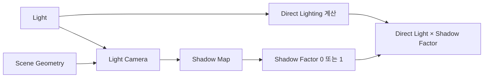
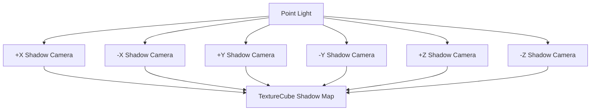

# 자체 엔진에 Directional, Point, Spot Light와 그림자 붙이기

디퍼드 렌더링을 만지다가 그림자가 보이지 않는 것을 발견했다.

처음에는 렌더 구조를 나누면서 Shadow Pass를 잘못 건드린 줄 알았다.

그런데 코드를 다시 보니 더 근본적인 문제가 있었다.

월드에 배치된 라이트가 없었다. 예전에 만든 라이트 값이 코드 안에 하드코딩되어 있었고, 에디터에서 위치나 방향을 확인할 방법도 없었다.

그래서 하드코딩된 라이트를 걷어내고 Hierarchy의 Add Object에서 Directional, Point, Spot Light를 직접 만들 수 있게 했다.

처음에는 세 라이트의 밝기 계산만 다르게 만들면 될 줄 알았다.

하지만 그림자까지 붙이려고 하니 이야기가 달라졌다. 라이트마다 장면을 바라보는 방식과 필요한 Shadow Map의 모양이 달랐다.

- Directional Light: 직교 투영 Shadow Map 한 장
- Spot Light: 원근 투영 Shadow Map 한 장
- Point Light: 여섯 방향을 담는 Cube Shadow Map

특히 Point Light는 여섯 방향을 그려야 했고, Shadow 깊이를 비교할 때 `length()`가 아니라 `max(abs())`가 필요했다.

왜 그렇게 구현했는지 코드를 따라가며 정리해보려 한다.

## 이번에 손댄 코드

| 파일 | 역할 |
|---|---|
| `GameEngine/DemoScene.cpp` | 에디터 오브젝트에서 GPU `lights[]` 배열을 수집하고 설정을 저장한다. |
| `GameEngine/GameEngine.cpp` | 라이트별 Shadow Camera 설정과 Shadow Pass 반복을 수행한다. |
| `DearsGraphicsEngine/Camera.cpp` | Direction/Up으로 안정적인 Light Camera 기저를 만든다. |
| `DearsGraphicsEngine/Renderer.cpp` | 2D Shadow Array와 Point Cube Array, DSV/SRV를 생성한다. |
| `GameEngine/RenderDispatcher.cpp` | 정적/PBR/스키닝/장비 메시를 각각 맞는 Shadow 셰이더로 보낸다. |
| `DearsGraphicsEngine/Shader/Common.hlsli` | 세 라이트의 직접광과 2D/Cube Shadow 비교를 공통 함수로 제공한다. |
| `DearsGraphicsEngine/Shader/PBRShadowVertexShader.hlsl` | 메인 PBR과 같은 Height 변형을 Shadow Pass에도 적용한다. |
| `DearsGraphicsEngine/ShadowMapDebugRenderer.cpp` | 선택한 라이트의 Shadow Map을 에디터에서 시각화한다. |

처음에는 라이트 방향선과 절두체를 그리면 위치를 확인하기 편하겠다고만 생각했다.

그런데 이 Debug Draw가 Shadow 문제를 찾는 데 꽤 중요했다.

```text
라이트가 밝기를 만드는 방향
라이트 카메라가 Depth를 그리는 방향
에디터가 보여주는 방향선과 절두체
```

이 셋이 같은 `direction`, near/far, FOV를 사용해야 한다. 하나라도 다른 축을 보면 빛은 오른쪽을 비추는데 그림자는 왼쪽에 생기는 일이 생긴다.

---

## 조명 계산과 그림자 계산은 다른 일이었다

라이트를 구현할 때는 다음 두 계산을 구분해야 한다.

```text
Direct Lighting
    현재 픽셀이 라이트로부터 얼마나 밝게 보이는가?

Shadow Mapping
    현재 픽셀과 라이트 사이를 다른 물체가 가리고 있는가?
```

Direct Lighting은 라이트 방향, 거리, 표면 노멀과 재질을 사용한다. Shadow Mapping은 라이트 위치에서 장면을 먼저 렌더링한 Depth Map을 사용한다.



그림자 계수는 해당 라이트의 직접광에만 곱한다.

```hlsl
float3 directLight = EvaluateLight(light, surface);
float shadowFactor = CalculateShadowFactor(light, surface);
directLight *= shadowFactor;
```

최종 색상 전체나 IBL까지 그림자로 곱하면 그림자 영역이 지나치게 검게 보이므로 주의해야 한다.

---

## 세 라이트는 밝기를 어떻게 계산할까

### Directional Light

태양처럼 매우 멀리 있는 광원을 가정한다. 모든 픽셀이 같은 방향의 빛을 받으므로 위치와 거리 감쇠를 사용하지 않는다.

```hlsl
float3 lightVector = normalize(-light.direction);
```

### Point Light

한 점에서 모든 방향으로 빛을 방출한다.

```hlsl
float3 toLight = light.position - positionWorld;
float distanceToLight = length(toLight);
float3 lightVector = toLight / distanceToLight;
```

현재 엔진은 `fallOffStart`와 `fallOffEnd`를 사용한 선형 거리 감쇠를 사용한다. 물리 기반 역제곱 감쇠는 이후 개선할 수 있다.

### Spot Light

Point Light의 위치와 거리 감쇠에 방향과 원뿔 범위가 추가된다.

```text
Point Light
    + Direction
    + Cone Angle
    + Spot Power
    = Spot Light
```

현재 Spot Light는 Shadow FOV를 바깥 원뿔 각도로 함께 사용한다. 따라서 에디터에 보이는 절두체와 실제 조명 범위, Shadow Camera 범위가 같은 방향을 바라본다.

`Spot Power`는 원뿔 내부에서 중심에 가까울수록 빛이 얼마나 집중되는지를 조절한다.

---

## Shadow Map은 어떤 순서로 만들어지나

Shadow Mapping은 장면을 두 번 바라보는 방식이다.

```text
1. 라이트 위치에서 장면을 렌더링한다.
2. 가장 가까운 표면의 Depth를 Shadow Map에 기록한다.
3. 메인 카메라 렌더링에서 현재 픽셀을 라이트 공간으로 변환한다.
4. 현재 픽셀의 깊이와 Shadow Map 깊이를 비교한다.
5. 현재 픽셀이 더 멀다면 앞에 가림 물체가 있으므로 그림자로 처리한다.
```

```hlsl
float shadowFactor =
    receiverDepth - bias > shadowMapDepth
    ? 0.0f
    : 1.0f;
```

Shadow Map에 기록되지 않은 텍셀은 Depth Clear 값인 `1.0`을 유지한다. 이 경우 Near/Far 범위 안의 픽셀은 일반적으로 그림자가 아닌 것으로 판정된다.

---

## Directional Light는 왜 직교 투영일까

Directional Light는 모든 광선이 평행하다고 가정한다. 따라서 원근 투영처럼 멀어질수록 Shadow 영역이 넓어지면 라이트의 성질과 맞지 않는다.

```text
Directional Light

→ → → → →
→ → → → →     평행한 광선
→ → → → →
```

Directional Shadow Camera는 직교 투영을 사용한다.

```cpp
Matrix::CreateOrthographic(
    shadowWidth,
    shadowHeight,
    shadowNear,
    shadowFar);
```

에디터의 `Shadow Width`는 직교 투영이 장면에서 담을 가로 범위를 뜻한다. 범위를 너무 크게 잡으면 같은 Shadow Map 해상도에 더 넓은 월드를 담게 되어 그림자가 흐려진다.

---

## Spot Light는 왜 원근 투영일까

Spot Light는 한 점에서 원뿔 형태로 퍼진다. 카메라의 원근 절두체와 모양이 같으므로 한 대의 Perspective Camera를 사용한다.

```cpp
Matrix::CreatePerspectiveFieldOfView(
    shadowFovY,
    1.0f,
    shadowNear,
    shadowFar);
```

Spot Light의 Transform에서 다음 축을 사용한다.

```text
Local +Z = 빛이 보는 방향
Local +Y = Shadow Camera의 Up 방향
```

Spot Light를 회전하면 직접광 방향, 디버그 절두체, Shadow View Matrix가 모두 같은 축을 사용해야 한다. 이 셋 중 하나라도 다른 축을 사용하면 빛은 오른쪽을 비추는데 그림자는 왼쪽으로 생기는 문제가 발생한다.

---

## Point Light에는 왜 카메라가 여섯 대 필요할까

Point Light는 모든 방향을 비춘다. 일반적인 2D Shadow Map 한 장은 한 방향만 볼 수 있으므로 여섯 방향을 각각 90도 카메라로 렌더링한다.

```text
+X, -X
+Y, -Y
+Z, -Z
```

각 카메라는 다음 조건을 공유한다.

```text
Position = Point Light 위치
FOV      = 90도
Aspect   = 1:1
Near/Far = 같은 값
```

여섯 장의 Depth는 하나의 TextureCube로 묶인다.



---

## Point Shadow에서 왜 `length()`를 쓰면 안 될까

현재 Point Shadow Map은 라이트로부터의 선형 거리를 직접 저장하지 않는다. 여섯 카메라가 일반 D32 Depth Buffer에 원근 투영 깊이를 기록한다.

따라서 비교할 픽셀도 선택된 Cube 면 카메라와 같은 View-Space Z를 구해야 한다.

```hlsl
float3 lightToPixel = positionWorld - light.position;

float receiverFaceDepth = max(
    abs(lightToPixel.x),
    max(abs(lightToPixel.y), abs(lightToPixel.z)));
```

예를 들어 다음 방향을 생각해보자.

```text
lightToPixel = (3, 1, -2)
abs          = (3, 1, 2)
```

가장 큰 축은 `+X`다. GPU는 Cube Map을 샘플링할 때 `+X` 면을 고른다.

`+X` 면 카메라에서는 월드의 `+X`가 카메라 전방, 즉 View-Space Z가 된다.

```text
실제 방사형 거리       = length(3, 1, -2) ≈ 3.74
+X 면 카메라의 View Z = 3
```

Shadow Pass가 기록한 값은 View Z 3을 원근 투영한 값이다. 비교할 때 `length()`인 3.74를 투영하면 서로 다른 기준의 깊이를 비교하게 된다.

```text
일반 Perspective Depth를 저장했다
    → max(abs(x), abs(y), abs(z)) 사용

라이트로부터 선형 거리를 직접 저장했다
    → length(lightToPixel) 사용
```

현재 엔진은 첫 번째 방식이므로 `max(abs())`가 맞다.

---

## 두 축의 절댓값이 같으면 어느 면을 고를까

다음 방향은 `+X`와 `+Y` 면의 경계를 정확히 향한다.

```text
lightToPixel = (1, 1, 0)
```

`max()`는 면을 선택하지 않고 깊이값 `1`만 계산한다. 실제 Cube 면 선택은 다음 TextureCube 샘플링에서 GPU가 수행한다.

```hlsl
pointShadowMap.Sample(
    shadowPointSampler,
    float4(lightToPixel, lightIndex));
```

Direct3D 11.3에서 가장 큰 축이 같을 때의 우선순위는 다음과 같다.

```text
Z → Y → X
```

따라서 `(1, 1, 0)`은 `+Y`, `(1, 1, -1)`은 `-Z` 면을 선택한다. 자세한 규칙은 [Direct3D 11.3 Functional Specification](https://microsoft.github.io/DirectX-Specs/d3d/archive/D3D11_3_FunctionalSpec.htm)의 TextureCube 샘플링 항목에서 확인할 수 있다.

어느 후보 면을 골라도 View-Space Z는 같은 값이다.

```text
+X 면 기준 View Z = 1
+Y 면 기준 View Z = 1
```

수학적으로 깊이 비교에는 문제가 없지만, 실제 텍셀 해상도와 래스터라이징 오차 때문에 Cube 면 경계에 가느다란 이음새가 생길 가능성은 있다.

---

## Cube 면 사이에 그려지지 않는 공간이 생기지 않을까

2차원에서 네 카메라가 각각 90도를 담당한다고 생각해보자.

```text
+X:  -45도 ~  45도
+Y:   45도 ~ 135도
-X:  135도 ~ 225도
-Y:  225도 ~ 315도
```

방향 범위는 정확히 맞닿으므로 각도상의 빈 공간은 없다. 만약 Near Plane 바깥인데도 카메라 사이에 틈이 보인다면 FOV가 90도가 아니거나 카메라 방향이 정확히 수직이 아닌 것이다.

하지만 모든 카메라는 Near Plane부터 렌더링하므로 라이트 바로 주변에는 실제 미기록 영역이 생긴다.

2차원 조건은 다음과 같다.

```hlsl
max(abs(x), abs(y)) < nearPlane;
```

3차원에서는 라이트를 둘러싼 작은 정육면체 영역이 된다.

```hlsl
max(abs(x), abs(y), abs(z)) < nearPlane;
```

예를 들어:

```text
Near Plane = 1.0
위치       = (0.8, 0.8)

length()            = 1.13
receiverFaceDepth   = 0.8
```

실제 거리는 Near보다 멀어 보이지만 모든 Cube 면 카메라 기준으로는 Near 안쪽이므로 어느 Depth에도 기록되지 않는다.

현재 코드에서 직접광의 거리 감쇠는 `length()`를 사용하는 것이 맞다. 반면 Shadow Camera의 Near/Far 범위 판정은 이후 `receiverFaceDepth` 기준으로 통일하는 것이 더 정확하다.

```text
라이트 거리 감쇠 판단 → length(lightToPixel)
Cube Shadow 범위 판단 → max(abs(x), abs(y), abs(z))
```

---

## 라이트가 여러 개면 Shadow Map은 어디에 저장할까

여러 Directional/Spot Shadow는 `Texture2DArray`, 여러 Point Shadow는 `TextureCubeArray`에 저장한다.

현재 구현은 GPU의 `lights[]` 인덱스를 Shadow 배열 인덱스로 그대로 사용한다.

현재 `Common.hlsli`의 `MAX_LIGHTS`는 3이다. 이는 DX11이 라이트를 세 개만 그릴 수 있다는 뜻이 아니라, 지금 공통 상수 버퍼와 Shadow 배열을 학습 단계의 고정 크기로 둔 값이다. 라이트 수를 늘리기 전에 화면에 영향을 주는 라이트 선별, Shadow를 실제로 만드는 라이트 선별, GPU 전달 방식을 분리해야 한다.

```text
lights[0] Directional → 2D Array Slice 0
lights[1] Spot       → 2D Array Slice 1
lights[2] Point      → Cube Array Index 2
```

Point Light의 실제 2D 슬라이스는 다음 식으로 찾는다.

```cpp
arraySlice = lightIndex * 6 + faceIndex;
```

따라서 `lights[2]`가 Point Light라면 실제 2D 슬라이스 12~17을 사용한다.

이 방식은 셰이더에서 별도 인덱스를 찾지 않아도 되어 단순하지만, 라이트 타입이 섞이면 사용하지 않는 Shadow 슬롯이 많이 생긴다.

앞으로는 다음처럼 Light 배열 인덱스와 Shadow 배열 인덱스를 분리하는 편이 좋다.

```cpp
struct Light
{
    int shadowMapIndex = -1;
};
```

```text
GPU Light Index   = 조명 계산에서의 순서
Shadow Map Index  = 해당 타입의 Shadow 배열에서의 연속 슬롯
```

그렇게 하면 GPU 라이트는 64개를 유지하면서 Shadow를 만드는 라이트만 별도의 작은 배열에 담을 수 있다.

---

## Height를 올렸는데 그림자는 원래 구체였다

PBR Vertex Shader는 Height Map을 읽어 정점을 노멀 방향으로 이동시킨다. 하지만 기존 Shadow Vertex Shader는 원본 정점만 그렸다.

```text
화면에 보이는 메시       = Height 변형 적용
Shadow Map에 그린 메시   = 원본 정점
```

이 상태에서는 화면의 울퉁불퉁한 실루엣과 그림자 모양이 일치하지 않는다.

그래서 PBR Shadow 전용 Vertex Shader를 추가해 메인 PBR Pass와 같은 Height 변형을 수행하도록 변경했다.

```text
PBR Main VS
    HeightTex + HeightScale

PBR Shadow VS
    HeightTex + HeightScale
```

다만 이것은 Vertex Displacement다. 원본 정점이 적은 모델은 Height Map이 있어도 실루엣이 충분히 촘촘해지지 않는다. 이후 Tessellation을 추가하면 이 한계를 줄일 수 있다.

---

## 아직 남은 문제

현재 구현에서 남아 있는 과제는 다음과 같다.

1. `MAX_LIGHTS`와 Shadow를 만드는 라이트 수 분리
2. `shadowMapIndex = -1`을 이용한 라이트별 Shadow On/Off
3. Point Shadow의 여섯 번 Draw 비용을 줄이기 위한 Culling과 Cache
4. 하드 섀도우를 부드럽게 만드는 PCF
5. Bias를 라이트 종류와 표면 기울기에 맞게 조절
6. Cube 면 경계 품질 검증
7. Height Displacement용 Tessellation
8. 많은 라이트를 위한 Tiled/Clustered Lighting 검토

처음에는 라이트 종류별 공식만 바꾸면 될 줄 알았다.

하지만 실제로 더 헷갈렸던 것은 Shadow Camera였다.

Directional은 직교 투영, Spot은 원근 투영, Point는 여섯 방향의 Cube Shadow가 필요했다. 직접광 계산과 Shadow Camera를 분리해서 보고 나니 왜 그림자가 엉뚱한 위치에 생겼는지도 조금씩 보이기 시작했다.

다음에는 지금의 딱딱한 그림자에 PCF를 붙이고, `MAX_LIGHTS`와 실제 Shadow Slot도 분리해보려 한다.
