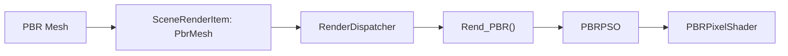
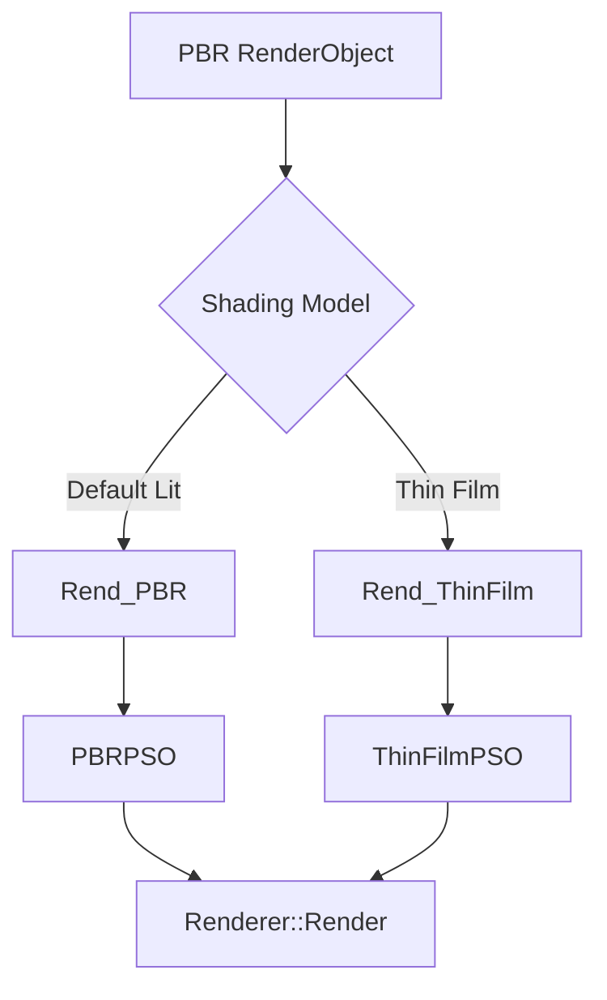

# 예전에 만든 Thin Film 셰이더가 왜 화면에 나오지 않았을까

예전에 비눗방울 같은 얇은 막의 간섭색을 표현해보고 싶어서 Thin Film 셰이더를 만든 적이 있었다.

코드를 다시 찾아보니 생각보다 많은 것이 남아 있었다.

- `ThinFilmPixelShader.hlsl`
- `ThinFilmPSO`
- `MeshRenderer::RenderThinFilmModel()`
- `DearsGraphicsEngine::Rend_ThinFilm()`
- Thin Film 전용 Constant Buffer

코드만 보면 필요한 것은 거의 다 있어 보였다.

그래서 처음에는 Thin Film도 이미 하나의 Pass로 동작하고 있는 줄 알았다.

하지만 화면에서는 Thin Film을 선택할 방법이 없었고, Inspector의 기존 체크박스를 눌러도 실제 셰이더는 바뀌지 않았다.

원인은 셰이더가 없는 것이 아니었다.

씬의 렌더 흐름에서 그 셰이더를 호출하는 길이 없었다.

이번에는 이 코드를 실제 오브젝트의 재질 선택으로 연결하면서, Pass와 Shading Model이 어떻게 다른지도 같이 정리해보려 한다.

## 이번에 손댄 코드

| 파일 | 역할 |
|---|---|
| `GameEngine/IScene.h` | `MaterialShadingModel::DefaultLit/ThinFilm`을 정의한다. |
| `GameEngine/RenderObject.cpp` | Shading Model 변경, b3 버퍼 지연 생성, PBR 설정 동기화를 담당한다. |
| `GameEngine/RenderDispatcher.cpp` | Forward PBR 메시를 Default Lit과 Thin Film 렌더 함수로 분기한다. |
| `DearsGraphicsEngine/MeshRenderer.cpp` | `ThinFilmPSO`를 선택해 실제 Draw를 실행한다. |
| `DearsGraphicsEngine/GraphicsCommon.cpp` | PBR PSO를 복사하고 Pixel Shader만 Thin Film으로 교체한다. |
| `DearsGraphicsEngine/Shader/ThinFilmPixelShader.hlsl` | 얇은 막의 굴절률, 두께와 시선 각도로 간섭색을 계산한다. |
| `GameEngine/SceneHierarchyPanel.h` | 오브젝트 생성 시 Shading Model과 막 파라미터를 받는다. |
| `GameEngine/ObjectInspectorPanel.h` | 실행 중 Shading Model과 Thin Film 값을 편집한다. |
| `GameEngine/DemoScene.cpp` | Scene Version 6 형식으로 설정을 저장하고 복원한다. |

처음에는 `RenderPassType::ThinFilm`을 하나 추가하면 되나 생각했다.

그런데 Thin Film은 장면 전체를 다시 처리하는 기능이 아니다.

같은 PBR 메시를 그리되 최종 표면색을 다른 공식으로 계산하는 재질 선택지에 가깝다. 그래서 새로운 Frame Pass가 아니라 Shading Model로 넣었다.

---

## 셰이더 파일이 있다고 실행되는 것은 아니었다

기존 PBR 오브젝트의 흐름은 다음과 같았다.



Thin Film 함수는 만들어져 있었지만 `RenderDispatcher` 어디에서도 `Rend_ThinFilm()`을 호출하지 않았다.

인스펙터의 기존 `Thin Film` 체크박스도 렌더 셰이더를 바꾸지 않았다. 이 값은 Thin Film Constant Buffer를 갱신할지 표시할 뿐이었다.

```text
Thin Film bool = true
    → b3 Constant Buffer 갱신

실제 렌더 분기
    → 여전히 Rend_PBR()
```

결국 b3에 데이터를 아무리 올려도 현재 Pixel Shader가 b3를 읽지 않으므로 화면은 바뀌지 않는다.

---

## Pass와 Shading Model은 무엇이 다를까

Thin Film을 연결하기 전에 이 효과가 새로운 Pass인지 먼저 판단해야 했다.

| 개념 | 결정하는 것 | 예시 |
|---|---|---|
| Render Pass | 프레임의 어느 단계에서 어떤 입출력을 사용할지 | Shadow, Geometry, Lighting, Forward, UI |
| Render Path | 오브젝트가 어떤 Pass 조합을 따라갈지 | Forward, Deferred |
| Shading Model | 표면의 최종 조명과 색상을 어떤 공식으로 계산할지 | Default Lit, Thin Film |
| PSO | 실제 GPU 셰이더와 렌더 상태의 묶음 | PBRPSO, ThinFilmPSO |

Thin Film은 새로운 렌더 타깃을 만들거나 프레임 전체를 한 번 더 처리하지 않는다. 같은 PBR 메시와 텍스처를 사용하면서 Pixel Shader의 표면 계산만 바꾼다.

따라서 다음 구조가 자연스럽다.

```text
Forward Pass
    ├─ Default Lit → PBRPSO
    └─ Thin Film   → ThinFilmPSO
```

`RenderPassType::ThinFilm`을 추가하면 Pass와 재질 종류가 섞이게 된다. 이번 작업에서는 Thin Film을 `MaterialShadingModel`로 분리했다.

```cpp
enum class MaterialShadingModel
{
    DefaultLit,
    ThinFilm,
};
```

---

## Render Type과 Shading Model도 나눴다

현재 엔진의 `SceneRenderType::PbrMesh`는 어떤 정점 데이터와 PBR 버퍼를 준비해야 하는지를 알려준다.

```text
Render Type: PBR Mesh
    → PBR Vertex Constant Buffer
    → PBR Texture Set
    → Height Map 처리
    → PBR Shadow 경로
```

하지만 같은 PBR Mesh라도 표면 표현은 달라질 수 있다.

```text
PBR Mesh
    ├─ Default Lit
    ├─ Thin Film
    ├─ Clear Coat        [향후]
    ├─ Subsurface        [향후]
    └─ Unlit             [향후]
```

따라서 Thin Film을 `SceneRenderType::ThinFilmMesh`로 추가하는 것보다 PBR Mesh 안의 Shading Model로 두는 편이 재질 시스템 확장에 유리하다.

---

## 끊겨 있던 렌더 흐름 연결하기

현재 Forward Dispatcher는 PBR Mesh를 만났을 때 오브젝트의 Shading Model을 확인한다.

```cpp
case SceneRenderType::PbrMesh:
    if (item.object->GetShadingModel() ==
        MaterialShadingModel::ThinFilm)
    {
        graphicsEngine->Rend_ThinFilm(modelBuffer);
    }
    else
    {
        graphicsEngine->Rend_PBR(modelBuffer);
    }
    break;
```

전체 흐름은 다음과 같다.



`ThinFilmPSO`는 기존 `PBRPSO`를 복사한 다음 Pixel Shader만 교체하는 구조다.

```cpp
ThinFilmPSO = PBRPSO;
ThinFilmPSO.m_pPixelShader = ThinFilmPS;
```

따라서 입력 레이아웃, PBR Vertex Shader, Depth/Rasterizer 상태와 텍스처 바인딩은 재사용한다.

---

## 왜 Thin Film은 Forward에서만 그리게 했나

현재 Deferred Geometry Pass는 다음 정보만 G-Buffer에 기록한다.

```text
Albedo
World Normal
Metallic / Roughness / AO
Depth
```

Thin Film에는 추가로 다음 값이 필요하다.

- 바깥 매질 굴절률 `n1`
- 박막 굴절률 `n2`
- 막 두께 `d`
- 두께 변조값 `time`
- 시선과 표면 노멀의 각도

현재 G-Buffer에는 Thin Film 재질을 구분하는 Material ID와 박막 매개변수를 저장하지 않는다. Deferred Lighting Shader도 Thin Film 공식을 알지 못한다.

그래서 현재는 다음 규칙을 적용했다.

```text
Default Lit
    → Forward 또는 Deferred 선택 가능

Thin Film
    → Forward로 자동 고정
```

Deferred Geometry Pass에서도 Shading Model이 `DefaultLit`인 오브젝트만 기록한다. 이 검사가 없으면 Thin Film 오브젝트가 G-Buffer에도 기록되고 Forward에서도 다시 그려지는 중복 처리가 생길 수 있다.

---

## 체크박스를 누르니 Constant Buffer에서 터졌다

Thin Film Pixel Shader는 b3 Constant Buffer를 사용한다.

```hlsl
cbuffer ThinFilmConstantBuffer : register(b3)
{
    float n1;
    float n2;
    float time;
    int d;
    // PBR texture flags and material...
}
```

기존 Render Flag UI처럼 bool만 `true`로 바꾸면 GPU 버퍼가 없는 상태에서 `Map()`을 호출해 크래시가 발생할 수 있다.

그래서 Shading Model 변경은 반드시 `SetShadingModel()`을 통과하도록 했다.

```cpp
void RenderObject::SetShadingModel(
    MaterialShadingModel shadingModel)
{
    mShadingModel = shadingModel;

    if (mShadingModel != MaterialShadingModel::ThinFilm)
    {
        return;
    }

    SynchronizeThinFilmMaterialData();

    if (!mIs_PSThinFilmConstant ||
        !mpModelBuffer->m_PSThinFilmConstantBuffer)
    {
        CreatePSThinFilmConstantBuffer();
    }
}
```

이 방식은 Thin Film이 실제로 선택된 오브젝트에만 b3 버퍼를 만드는 지연 생성 방식이다.

---

## PBR 텍스처 설정이 Thin Film에서는 사라졌다

Thin Film Shader도 다음 PBR 입력을 사용한다.

- Albedo Texture
- Normal Texture
- AO Texture
- Metallic Texture
- Roughness Texture
- PBR Material 값

하지만 PBR Shader는 b2, Thin Film Shader는 b3를 사용하므로 두 버퍼에 같은 재질 상태가 필요하다.

```cpp
void RenderObject::SynchronizeThinFilmMaterialData()
{
    thinFilm.useAlbedoMap = pbr.useAlbedoMap;
    thinFilm.useNormalMap = pbr.useNormalMap;
    thinFilm.useAOMap = pbr.useAOMap;
    thinFilm.useMetallicMap = pbr.useMetallicMap;
    thinFilm.useRoughnessMap = pbr.useRoughnessMap;
    thinFilm.material = pbr.material;
}
```

Inspector에서 Metallic이나 Roughness를 바꾼 뒤 Thin Film만 예전 값을 사용하는 문제를 막기 위해 업데이트 전에 동기화한다.

현재는 안전하고 이해하기 쉬운 방법이지만 동일 데이터를 b2와 b3에 중복 보관한다. 이후 Material Parameter 구조를 별도 GPU 버퍼로 분리하면 중복을 줄일 수 있다.

---

## 에디터에서 고르고 다음 실행에도 남게 만들기

Add Object에서 PBR Mesh를 고르면 다음 Shading Model을 선택할 수 있다.

```text
Default Lit
Thin Film
```

Thin Film을 선택하면 다음 값도 함께 설정한다.

```text
Outside IOR
Film IOR
Film Thickness
Thickness Modulation
```

생성 후 Inspector에서도 Shading Model과 값을 실시간으로 바꿀 수 있다.

Scene 파일은 Version 6으로 올리고 다음 데이터를 저장한다.

```text
Shading Model
n1 / n2
Thickness Modulation
Film Thickness
```

Version 5 이하의 Scene은 `DefaultLit`으로 읽는다. 기존 파일에 존재하지 않는 값을 억지로 읽지 않고 구조체 기본값을 사용해 이전 Scene과의 호환성을 유지한다.

---

## 지금 Thin Film 셰이더는 어떻게 색을 만들까

얇은 막의 위아래 표면에서 반사된 빛은 이동한 거리가 다르다. 두 빛의 광학 경로 차이에 따라 특정 파장은 강해지고 다른 파장은 약해진다.

현재 셰이더는 다음 형태로 광학 경로 차이를 계산한다.

```hlsl
float OPD = 2.0 * n2 * thickness * cosTheta;
```

그리고 RGB를 대표하는 파장을 정해 간섭색을 만든다.

```hlsl
float R = sin(2.0 * PI * OPD / 650.0);
float G = sin(2.0 * PI * OPD / 510.0);
float B = sin(2.0 * PI * OPD / 475.0);
```

표면을 정면에서 볼 때와 비스듬히 볼 때 `cosTheta`와 Fresnel 값이 달라지므로 보는 각도에 따라 색이 변한다.

```text
굴절률 + 막 두께 + 입사각
    → 광학 경로 차이
    → 파장별 위상 차이
    → RGB 간섭색
```

---

## 아직 완성된 Thin Film은 아니다

이번 작업은 Thin Film 셰이더를 엔진의 실제 렌더 흐름에 연결한 것이다. 셰이더의 물리 모델까지 완성한 것은 아니다.

현재 확인해야 할 부분은 다음과 같다.

1. Thin Film Shader가 최신 다중 직접광 계산을 사용하지 않는다.
2. 라이트별 Shadow Factor가 Thin Film 최종 색상에 아직 적용되지 않는다.
3. 계산해 둔 일부 PBR Ambient 값이 최종 출력에 사용되지 않는다.
4. RGB 세 파장과 `sin()`을 사용한 간략한 근사다.
5. `ThinFilmVertexShader.hlsl` 파일은 있지만 현재 PSO는 PBR Vertex Shader를 재사용한다.
6. Pixel Shader 출력 Alpha는 0.5지만 ThinFilmPSO의 Blend State를 별도로 정의하지 않았다.
7. `int d = 1.0f` 초기화에서 형 변환 경고가 남아 있다.

따라서 현재 단계의 의미는 다음과 같다.

```text
이전
Thin Film 코드가 존재하지만 호출되지 않음

현재
오브젝트별로 Thin Film을 선택하고 실제 화면에서 실행 가능

다음
최신 PBR 직접광, Shadow, IBL과 물리 모델을 다시 정리
```

---

## 다음에 고칠 것

1. Thin Film Shader에 현재 `MAX_LIGHTS` 루프 적용
2. 라이트별 Shadow Factor를 직접광에 적용
3. Default Lit과 중복되는 PBR 함수를 공통 HLSL로 정리
4. Thin Film 전용 파라미터의 단위 정의
5. Material ID를 이용한 Deferred Thin Film 지원 여부 검토
6. Clear Coat, Subsurface 같은 다른 Shading Model을 같은 구조로 확장

처음에는 Thin Film 셰이더 파일과 PSO가 있으니 이미 하나의 Pass가 있는 줄 알았다.

하지만 셰이더가 존재하는 것과 엔진에서 실제로 선택할 수 있는 것은 다른 문제였다.

이번에는 Scene의 Shading Model 값이 Dispatcher를 지나 실제 `ThinFilmPSO` 선택까지 이어지도록 길을 만들었다.

이제 효과는 화면에 나오지만 최신 다중 라이트, Shadow와 IBL은 아직 다시 연결해야 한다. 다음에는 Default Lit과 겹치는 PBR 계산부터 공통 HLSL로 정리해보려 한다.
