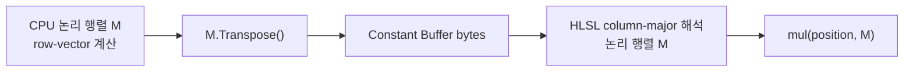
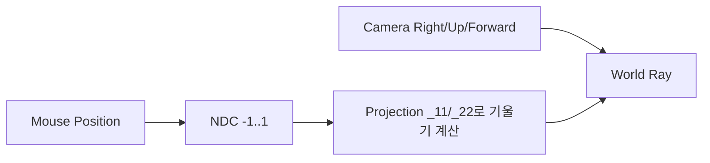

# 내 엔진은 행렬을 어떤 규칙으로 계산하고 있었을까

카메라를 움직이고 나면 피킹이 맞지 않는 문제가 있었다.

그 원인을 찾으면서 현재 엔진의 행렬 규칙과 피킹 Ray 계산이 어긋나기 쉽다는 이야기가 나왔다.

그 말을 듣고 이런 생각이 들었다.

```text
내 엔진은 왼손 좌표계를 썼던 것 같은데..?
그럼 행렬 곱 순서는 제대로 맞춰져 있나?
여기저기 붙어 있는 Transpose는 전부 필요한 건가?
```

솔직히 엔진을 만들 때는 화면에 잘 나오도록 `Transpose()`를 붙이거나 빼면서 맞춘 부분도 있었다.

정적 메시만 그릴 때는 큰 문제가 없어 보였다. 하지만 피킹, G-Buffer의 World Position 복원, Light Camera처럼 CPU와 GPU가 같은 공간을 공유하기 시작하니 숨겨둔 규칙이 하나씩 문제로 나타났다.

실제로 겪은 문제는 다음과 같았다.

- 카메라를 움직인 뒤 마우스 피킹 Ray가 화면과 다른 방향을 바라봤다.
- Spot/Directional Light의 방향선과 Shadow Camera가 서로 다른 방향을 보는 경우가 있었다.
- Depth에서 World Position을 복원할 때 `invViewProj`가 어떤 형태인지 다시 추적해야 했다.
- `world.Transpose().Invert()` 같은 코드는 결과는 맞아도 왜 맞는지 바로 이해하기 어려웠다.

행렬 이론을 처음부터 전부 정리하려는 것은 아니다.

우선 지금 DearsEngine 코드가 실제로 어떤 규칙으로 동작하는지부터 확인해보려 한다.

## 이번에 확인한 코드

| 파일 | 확인한 규칙 |
|---|---|
| `DearsGraphicsEngine/Camera.cpp` | `XMMatrixLookToLH`, `XMMatrixPerspectiveFovLH`, `XMMatrixOrthographicLH`를 사용한다. |
| `GameEngine/RenderObject.cpp` | CPU에서 `Scale * Rotation * Translation`을 만든 뒤 전치해서 업로드한다. |
| `DearsGraphicsEngine/DearsGraphicsEngine.cpp` | View, Projection, ViewProjection을 전치해 공통 상수 버퍼에 기록한다. |
| `DearsGraphicsEngine/Shader/PBRVertexShader.hlsl` | `mul(position, world)`, `mul(position, view)`, `mul(position, proj)` 순서로 계산한다. |
| `DearsGraphicsEngine/Shader/GBufferDebugPixelShader.hlsl` | `mul(clipPosition, invViewProj)`로 World Position을 복원한다. |
| `GameEngine/PickingManager.cpp` | GPU 업로드 행렬 대신 Camera의 Right/Up/Forward 기저로 Ray를 만든다. |
| `GameEngine/GameEngine.cpp` | Light의 `viewProj`도 `(View * Projection).Transpose()` 형태로 업로드한다. |
| `DearsGraphicsEngine/DebugRenderer.cpp` | 디버그 도형의 World 행렬 역시 전치한 뒤 GPU에 전달한다. |

코드를 따라가 보니 다행히 아무 규칙 없이 돌아가고 있던 것은 아니었다.

일반 메시, PBR, G-Buffer, Shadow와 Debug Draw가 대체로 같은 규칙을 반복하고 있었다.

문제는 그 규칙이 한곳에 적혀 있지 않고 각 파일의 `Transpose()` 호출로 흩어져 있다는 점이었다.

---

## 먼저 헷갈리던 세 가지를 나눠보자

행렬 문제를 이야기할 때 자주 섞이는 개념은 다음 세 가지다.

| 개념 | DearsEngine의 현재 선택 | 의미 |
|---|---|---|
| 좌표계 Handedness | Left-Handed | +Z가 카메라의 기본 Forward다. |
| 벡터 곱 방향 | Row Vector | 셰이더에서 `mul(position, matrix)`를 사용한다. |
| GPU 행렬 저장 방식 | HLSL 기본 Column-Major | 상수 버퍼에 넣기 전에 CPU 행렬을 전치한다. |

좌손 좌표계를 쓴다고 반드시 row-vector를 써야 하는 것은 아니다. column-major 저장을 쓴다고 column-vector 계산을 해야 하는 것도 아니다. 세 항목은 관련은 있지만 같은 선택이 아니다.

따라서 “왼손이라 행렬을 전치한다”는 설명은 정확하지 않다.

```text
좌손/오른손
    -> 축과 회전, 앞/뒤 방향에 관한 규칙

row-vector/column-vector
    -> 벡터를 행렬의 어느 쪽에서 곱하는가에 관한 규칙

row-major/column-major
    -> 행렬 원소를 메모리에 어떤 순서로 저장하는가에 관한 규칙
```

---

## 내 엔진은 정말 좌손 좌표계였나

`Camera`의 기본 방향은 다음과 같다.

```cpp
mViewPos = Vector3(0, 0, 0);
mViewDir = Vector3(0, 0, 1);
mViewUp  = Vector3(0, 1, 0);
mRightDir = Vector3(1, 0, 0);
```

View와 Projection도 명시적으로 LH 함수를 사용한다.

```cpp
XMMatrixLookToLH(mViewPos, mViewDir, mViewUp);
XMMatrixPerspectiveFovLH(fovY, aspect, nearZ, farZ);
XMMatrixOrthographicLH(width, height, nearZ, farZ);
```

즉 현재 엔진의 월드에서는 카메라 앞쪽이 기본적으로 +Z다. 카메라, 피킹, 라이트 기즈모, Shadow Camera가 모두 이 기준을 사용해야 한다.

중요한 점은 `SimpleMath::Matrix`라는 타입 자체가 좌손 좌표계를 강제하는 것이 아니라는 것이다. 어떤 View/Projection 생성 함수를 사용하고 Forward 축을 어떻게 정의하는지가 좌표계를 결정한다.

---

## CPU에서는 어떤 순서로 World를 만들고 있었나

`RenderObject::Update()`에서 World 행렬은 다음 순서로 만들어진다.

```cpp
Matrix worldCpu = ObjectScl * ObjectRot * ObjectPos;
```

row-vector 규칙에서 한 점 `p`는 다음 순서로 변환된다.

```text
pWorld = pLocal * Scale * Rotation * Translation
```

따라서 코드의 `Scale * Rotation * Translation`은 로컬 정점에 Scale, Rotation, Translation을 차례로 적용하려는 현재 규칙과 맞는다.

SimpleMath의 Translation 행렬에서 위치가 `_41`, `_42`, `_43`에 있는 것도 이 규칙과 연결된다. 실제로 `RenderDispatcher`는 오브젝트 위치를 읽을 때 이 세 값을 사용한다.

```cpp
Vector3 worldPosition(
    object.ObjectPos._41,
    object.ObjectPos._42,
    object.ObjectPos._43);
```

---

## 그런데 왜 GPU에 보낼 때 Transpose할까

PBR Vertex Shader는 row-vector 형태로 계산한다.

```hlsl
float4 positionWorld = mul(float4(input.pos, 1.0f), world);
float4 positionView  = mul(positionWorld, view);
float4 positionClip  = mul(positionView, proj);
```

문제는 C++ `Matrix`의 메모리 배치와 HLSL `matrix`의 기본 상수 버퍼 배치가 같지 않다는 점이다. HLSL은 별도 지정이 없으면 행렬을 column-major 형태로 배치한다.

현재 코드는 이 저장 방식 차이를 CPU에서 전치해서 맞춘다.

```cpp
Matrix worldCpu = ObjectScl * ObjectRot * ObjectPos;
constantBuffer.world = worldCpu.Transpose();
```

흐름을 개념적으로 표현하면 다음과 같다.



즉 전치는 좌손 좌표계를 고치는 연산이 아니다. **CPU와 HLSL 사이의 저장 규칙을 연결하는 업로드 변환**이다.

이 규칙은 다음 코드에도 동일하게 적용된다.

```cpp
common.view = camera.GetViewRow().Transpose();
common.proj = camera.GetProjRow().Transpose();
common.viewProj = (camera.GetViewRow() * camera.GetProjRow()).Transpose();

light.viewProj =
    (lightCamera.GetViewRow() * lightCamera.GetProjRow()).Transpose();
```

셰이더에서는 전치된 값을 받았다는 사실을 다시 신경 쓰지 않고 row-vector 규칙으로 사용한다.

```hlsl
float4 clip = mul(float4(positionWorld, 1.0f), light.viewProj);
```

---

## `world.Transpose().Invert()`는 대체 무엇이었을까

현재 `RenderObject`에는 다음 코드가 있다.

```cpp
world = worldCpu.Transpose();
invWorld = world.Transpose().Invert();
```

`world` 변수는 이름과 달리 이미 GPU 업로드용으로 전치된 행렬이다. 따라서 `world.Transpose()`를 한 번 더 하면 원래 CPU 논리 행렬 `M`으로 돌아간다.

```text
world                  = M^T
world.Transpose()      = M
Invert()               = M^-1
HLSL column-major 해석 = (M^-1)^T
```

최종적으로 셰이더가 보는 것은 Normal 변환에 필요한 inverse-transpose 행렬이다.

```hlsl
normalWorld = mul(normalModel, invWorld);
```

수학적으로는 의도한 결과가 맞지만, CPU 논리 행렬과 GPU 업로드 행렬을 같은 `world` 변수에 섞어 저장했기 때문에 코드를 처음 읽으면 불필요한 전치처럼 보인다.

더 읽기 쉬운 형태는 다음과 같다.

```cpp
const Matrix worldCpu = scale * rotation * translation;
const Matrix normalCpu = worldCpu.Invert().Transpose();

gpu.world = ToGpuMatrix(worldCpu);
gpu.normalMatrix = ToGpuMatrix(normalCpu);
```

이 형태라면 전치가 수학적 inverse-transpose인지, GPU 저장 변환인지 구분할 수 있다.

---

## Depth에서 World Position은 어떻게 돌아오나

G-Buffer는 World Position을 별도 Render Target에 저장하지 않는다. 화면 UV와 Depth를 Clip Position으로 만든 뒤 `invViewProj`를 곱해 복원한다.

```hlsl
float4 clipPosition = float4(ndcX, ndcY, depth, 1.0f);
float4 worldPosition = mul(clipPosition, invViewProj);
worldPosition.xyz /= worldPosition.w;
```

CPU에서는 GPU 업로드 형태의 `viewProj`를 먼저 만든 뒤 역행렬을 구한다.

```cpp
common.viewProj = (viewCpu * projCpu).Transpose();
common.invViewProj = common.viewProj.Invert();
```

행렬 성질을 적용하면 다음과 같다.

```text
viewProj upload = (V * P)^T
Invert          = ((V * P)^-1)^T
HLSL 해석       = (V * P)^-1
```

따라서 셰이더의 `mul(clipPosition, invViewProj)`는 현재 row-vector 규칙에서 올바른 World Position을 복원한다.

이 계산이 깨졌을 때 World Position 디버그 화면을 추가한 것이 유용했다. 숫자만 확인하는 대신 카메라를 움직였을 때 복원된 위치색이 오브젝트와 함께 안정적으로 움직이는지 눈으로 검증할 수 있었다.

---

## 카메라를 움직이면 피킹이 어긋났던 이유

처음 피킹 Ray는 ViewProjection 역행렬에 의존하려고 했다. 그러나 CPU에서 사용하는 원본 행렬과 GPU 업로드용 전치 행렬을 구분하지 않으면 다음 중 무엇을 뒤집고 있는지 쉽게 헷갈린다.

```text
CPU ViewProjection인가?
전치된 GPU ViewProjection인가?
Inverse 후 다시 Transpose해야 하는가?
```

이 혼란 때문에 카메라가 초기 방향일 때는 우연히 맞지만, 회전하거나 이동한 뒤 Ray가 렌더 화면과 달라질 수 있었다.

현재 `PickingManager::BuildRayFromScreen()`은 Projection의 기울기와 Camera의 현재 기저 벡터를 직접 사용한다.

```cpp
Vector3 rayDirection =
    camera->mRightDir * (ndcX / projection._11) +
    camera->mViewUp   * (ndcY / projection._22) +
    camera->mViewDir;
```



이 방식은 행렬 역변환 자체를 피하려는 영구적인 원칙은 아니다. 현재 엔진의 행렬 업로드 규칙이 여러 위치에 흩어진 상태에서 CPU 피킹을 GPU 저장 형식과 분리해 안정화한 선택이다.

행렬 규칙을 중앙화한 뒤에는 `XMVector3Unproject` 또는 명확한 CPU `InverseViewProjection` 경로로 바꿔도 된다.

---

## Light Camera만 다른 규칙을 쓰면 안 된다

Directional과 Spot Light의 Shadow Map은 Light Camera의 ViewProjection을 사용한다. Point Light도 Cube의 여섯 면마다 View와 Projection을 새로 만든다.

여기서 다음 세 값이 같은 기저를 사용해야 한다.

```text
Light의 direction
DebugRenderer가 그리는 방향선/절두체
Shadow Pass가 사용하는 Camera View
```

`Camera::SetDirection(direction, up)`은 두 벡터를 정규화하고 Right를 만든 뒤 Up을 다시 계산한다. 방향과 Up이 거의 평행하면 유효한 View 행렬을 만들 수 없으므로 안전한 기준축을 선택한다.

이 보정 없이 Rotation을 크게 바꾸면 직접광은 한쪽을 비추는데 Shadow Camera는 다른 방향을 보거나, View 행렬이 불안정해질 수 있다.

Light의 `viewProj`도 일반 카메라와 똑같이 CPU에서 `View * Projection`을 만든 뒤 전치해서 업로드한다. Shadow만 별도의 행렬 규칙을 사용하지 않는다는 점이 중요하다.

---

## 지금 구조에서 불안한 부분

현재 렌더 결과는 대체로 같은 규칙을 사용해 정상적으로 나온다. 하지만 규칙이 코드 구조로 강제되지 않고 개발자가 기억해야 한다.

### `Transpose()`가 여러 파일에 흩어져 있다

`RenderObject`, `DearsGraphicsEngine`, `GameEngine`, `DebugRenderer`, `AnimationHelper`가 각각 직접 전치한다. 한 경로에서 전치를 한 번 빼거나 두 번 하면 그 기능만 다른 공간을 사용하게 된다.

### 변수 이름이 논리 행렬과 업로드 행렬을 구분하지 않는다

`world`라는 이름만 보고 CPU World인지 이미 전치된 GPU 데이터인지 알 수 없다. `GetViewRow()`도 행렬의 벡터 곱 규칙을 말하는지 메모리 배치를 말하는지 모호하다.

### 좌표계와 메모리 배치가 주석에서 섞일 수 있다

LH/RH 문제와 Transpose 문제를 같은 원인으로 생각하면, 축을 고쳐야 할 때 저장 배치를 바꾸거나 반대로 저장 문제에 Z축 부호를 바꾸게 된다.

### 애니메이션과 특수 렌더 경로를 따로 검증해야 한다

Bone Matrix, Equipment Matrix, Particle Matrix도 자체적으로 전치하고 있다. 정적 PBR 메시가 맞는다고 모든 경로가 같은 규칙을 지킨다는 보장은 없다.

---

## RHI를 붙이기 전에 어떻게 정리할까

DX12와 Vulkan을 붙이기 전에 행렬 업로드 경계를 한 곳으로 모으는 편이 좋다.

### 방법 A: 현재 HLSL 기본 배치를 유지한다

```cpp
Matrix ToGpuMatrix(const Matrix& cpuMatrix)
{
    return cpuMatrix.Transpose();
}
```

모든 상수 버퍼 업로드는 이 함수만 사용하고, 게임 코드에서는 원본 CPU 행렬만 보관한다. 현재 셰이더를 가장 적게 바꾸는 방법이다.

### 방법 B: HLSL에 `row_major`를 명시한다

```hlsl
row_major float4x4 world;
```

이 경우 CPU 행렬을 전치하지 않는 규칙으로 바꿀 수 있다. 다만 모든 셰이더와 상수 버퍼를 한 번에 점검해야 하며, 현재처럼 두 규칙을 섞어 적용하면 더 위험하다.

지금 코드에서는 방법 A가 보수적이다. 먼저 `ToGpuMatrix()`, `BuildNormalMatrix()`, `BuildViewProjection()` 같은 공통 함수를 만들고 모든 직접 `Transpose()` 호출을 그 경계로 옮긴 뒤, 필요하다면 나중에 저장 정책을 바꾸는 편이 안전하다.

권장 변수 이름도 다음처럼 역할을 드러내는 편이 좋다.

```text
worldCpu
viewCpu
projectionCpu
viewProjectionCpu

gpuConstants.world
gpuConstants.view
gpuConstants.projection
```

---

## 지금 행렬 규칙을 한 번에 정리하면

```text
Coordinate System
    Left-Handed
    +X Right, +Y Up, +Z Forward

CPU Math
    Row-vector convention
    World = Scale * Rotation * Translation
    ViewProjection = View * Projection

HLSL Math
    mul(position, matrix)
    position * World * View * Projection

Upload Boundary
    CPU Matrix를 Transpose해서 Constant Buffer에 기록
    HLSL 기본 column-major 배치가 논리적으로 원래 행렬을 보게 함
```

정리하면서 알게 된 것은 `Transpose()`가 무조건 잘못된 코드는 아니라는 점이었다.

현재 규칙에서는 CPU 행렬을 HLSL 기본 column-major 저장 방식에 맞춰 넘기기 위해 필요한 변환이었다.

문제는 같은 작업을 여러 파일에서 각자 하고 있다는 것이다.

RHI를 붙이기 전에 행렬 체계를 새로 만들 필요는 없어 보인다. 우선 `ToGpuMatrix()` 같은 한 경계로 업로드 규칙을 모으고, CPU에서 계산하는 행렬과 GPU로 보낼 행렬을 이름부터 나누는 것이 먼저다.

그렇게 해두면 다음에 피킹이나 Shadow Camera가 어긋났을 때 무작정 `Transpose()`부터 붙였다 떼는 일은 조금 줄어들 것 같다. ㅎㅎ..
